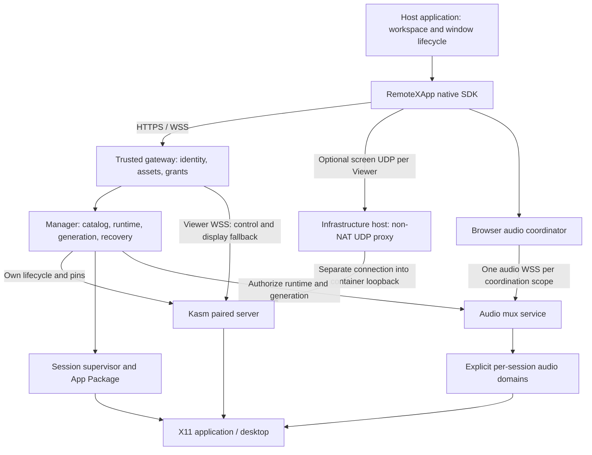

# Kasm 原生 RemoteXApp 架构提案 / Native architecture proposal

状态：**D1 已实现并完成限定自动化矩阵；Issue #30 / PR #31 跟踪验收与合并，默认值未切换。**
审阅更新：2026-10-28 用户批准 [D1 / Issue #30](https://github.com/woodegg/remotexapp/issues/30)
的 Kasm WSS、Manager 生命周期和最小 SDK 实施；R3 音频连接时机已于 2026-10-25 确认。
后续音频/UDP 和完整宿主接口决定仍按对应阶段审阅。
日期：2026-10-24。跟踪：[Issue #24](https://github.com/woodegg/remotexapp/issues/24)。
对照源码：`55ac56742c1938de854a177e5664e78d0efdc97d`，Core 0.15.0 / SDK 0.30.0。
0.16.0 仍为拟议发布列车，具体 SDK、App、状态格式版本在接口审阅后确定。

本文给出可供审阅的目标设计，不是当前安装手册。`proposed` 字段、接口和配置示例
均不能直接传给已发布版本。文中的“宿主应用（Host application）”指嵌入 SDK、
管理工作区和窗口的上层产品；“宿主机（Infrastructure host）”指运行容器的机器。
两者职责不同。

## 1. 决策摘要 / Decision summary

建议进入正式产品设计和分步实现：采用 **Kasm 成对的服务端与客户端**处理显示、
原生输入、剪贴板；保留 RemoteXApp 的应用管理、持久化、代际隔离、自恢复和
用户数据保护。宿主应用适配新的 SDK 契约，不把旧 IBus 桥接和旧方法形状当成
新架构的强制约束。Kasm 客户端本身源于 noVNC，不能宣称消除了所有 noVNC 源码。

建议的连接分工：

- **HTTPS/WSS**：身份与控制、Viewer 信令、可靠输入/剪贴板，以及画面基础路径。
- **可选 WebRTC UDP DataChannel**：每个 Viewer 的画面加速路径；失败时继续 WSS。
- **独立音频 WSS 复用通道**：一个服务器/浏览器协调作用域共享，各会话单独开关。
  它不复用画面的 UDP，也不意味着所有 Viewer 共用一个画面连接。

PoC 足以支持这些设计选择；不等于生产 Manager、完整授权、真实宿主集成和资源
验收已经完成。建议先交付完整 WSS 垂直切片，再逐步加入音频与受控 UDP。

<a id="evidence-boundary"></a>

## 2. 证据基线与限度 / Evidence boundary

接收的冻结研究基线为 **KNP-BASELINE-20261024**。本公开文档保留脱敏结论与
候选身份，原始抓包、SDP、heap、用户 profile 和运行位置不作为公开附件。
未来产品证据要能从同一个不可变候选复现，不能把多个历史版本的通过项相加。

| 证据 | 支持的设计判断 | 尚未证明 |
| --- | --- | --- |
| 上游 KasmVNC 1.5.0，server `17265facc40ab50db5740cdf0d12c61173edafc9`；client `475ecfa5356579ef222983c7ce4619a7576a3bce` | 服务端/浏览器客户端必须成对锁定；音频是独立组件 | 干净环境可分发构建、完整依赖/修改源清单与发行审查 |
| 加固候选 server `webrtc-hardening-20261023-4`；client `native-webrtc-private-5658bb59e0d1` | 原生显示与受限 IPv4 UDP、地址脱敏、认证和资源修复的开发参考 | 最新客户端与完整输入/音频/宿主的组合验收 |
| 自然 8 小时：28802.422 秒，1565 个样本，3 Viewer / 2 desktop，4 项传输检查通过 | 多连接传输持续性、主页面回调有界的证据 | 总体资源结论仍为 **inconclusive**；存在 Swap/宿主压力和测量框架干扰；不是更快或更省内存的证明 |
| 早期原生输入、文本/HTML/PNG 剪贴板、双会话音频及用户体验验收 | 原生能力可以替代多层旧桥接；复用音频可行 | 早期 UAT 不覆盖后来补丁；Windows/macOS/Linux 物理 IME、真实设备和浏览器矩阵仍需产品验收 |
| 多 Tab、两个 UID/Pulse 音频域、显式多目标 mic | 跨 Tab 去重和显式 mic 路由可行 | 同 UID 多 App 隔离、真实工作区隐藏/关闭语义、生产 ACL 尚未证明 |

8 小时负载是 800×600 周期性色块，不代表 Office、视频或高分辨率办公负载。
下一轮产品资源测量前，先解决测试框架的关闭页面/CDP 释放、Node 与 cgroup/
SwapPss 记录、浏览器退出和异常定性问题。保留原始失败与测量限制。

## 3. 总体结构 / System structure



这是逻辑边界，不要求每个方框新增守护进程。保留现有 Manager 为生命周期唯一
写入者；将 Viewer 授权、代理和静态资源职责从旧 `novnc-input` 耦合中拆清楚。
普通受信单用户安装可以合并进程。若要求“工作负载容器内任何进程看不到客户端
原始地址”，可信入口和浏览器资源必须由容器之外的可信部署提供，见第 7 节。
不引入 Kasm Workspaces 管理平台，也不把 App 生命周期交给容器镜像启动脚本。

## 4. 保留、适配、替换 / Component decisions

| 范围 | 决策 | 改动与理由 |
| --- | --- | --- |
| Manager、catalog、managed/anonymous runtime | **保留语义，适配组件模型** | 继续统一分配、持久化、授权和状态；固定 PoC desktop registry 不能替代 Manager |
| App Package、selected non-root UID、HOME/profile | **保留** | 应用启动/就绪/动作/优雅停止及数据所有权仍由 App 与 Manager 管理；逐个核验 launcher、环境和 readiness |
| `remotexapp/v1` App ABI | **优先保留，逐项审计** | 如确需改变音频/显示声明，采用显式扩展与版本要求；不因换显示后端批量增加 App 版本 |
| generation、显式 stop、shutdown veto、自恢复预算 | **保留并扩展覆盖通道** | 新 Viewer、UDP 协商、clipboard 和音频权限都受同一代际撤销 |
| systemd / standalone 生命周期后端 | **保留** | 显示 provider 与进程监督方式是两个维度；仍需分别验证重启、cgroup 和实际 reboot |
| TigerVNC + 当前 noVNC 集成 | **由 Kasm 成对替换** | 新 runtime 使用固定 server/client 组合；不把 Kasm client 接旧 TigerVNC |
| `novnc-input` 的输入/剪贴板桥接 | **新 provider 移除重复路径** | 人工输入和剪贴板使用原生协议；保留必要的认证代理和应用控制职责，不能直接删除整个进程后丢失 UNO/CDP 等功能 |
| Core IBus/Unicode engine | **按 provider 取消强制依赖** | Kasm 人工输入不再强制经过旧桥；应用需要的 D-Bus/输入服务仍按实际依赖保留，借用的 account bus 永不终止 |
| SDK Viewer/Console | **新增明确版本的 native adapter** | 保留“打开/释放/就绪/恢复”的含义；不向宿主暴露上游私有 RFB 对象或沿用不真实的 ACK |
| 连接页、菜单、品牌外观 | **中性 UI，保留来源声明** | 宿主可隐藏连接 logo/上游工具栏、使用统一状态控件；保留发行所需的版权/许可证，避免依赖上游 DOM 私有选择器 |
| 程序输入、clipboard API | **重新定义能力与结果** | 将 native 能力、传递结果、应用确认和不支持格式分开；禁止静默改用 clipboard 注入 |
| speaker/mic | **新增独立音频服务与协调器** | 每会话开关、同会话多 Tab 去重、显式目标；不把用户全局混音伪装成会话隔离 |
| WebRTC | **可选部署能力** | 基础 WSS 可完整使用；UDP 不通不应触发应用恢复或丢失数据 |
| 发布、UAT、部署所有权 | **保留** | 产品项目发布固定产物；部署项目拥有宿主机、防火墙、容器、重启和回退操作 |

旧 provider 仅在迁移/对照期间保留。长期目标是一套新的主要显示/输入体系，
不是永久维护两套完整前端并让每次输入同时经过两套桥接。

## 5. 数据模型、生命周期 / Runtime and lifecycle

### 5.1 必须分清的身份

| 对象 | 生命周期与作用 |
| --- | --- |
| Server identity | 逻辑服务身份及 API base path；不能只按 hostname 合并不同账户/服务 |
| Runtime | 用户可管理的远端应用/桌面实例；保留稳定 runtime ID、HOME、参数和期望状态 |
| Generation | runtime 一次有效 session 生命期；替换时递增，旧输入、音频、clipboard、UDP 全部失效 |
| Viewer | 一个视图附件；同一 runtime 可以有多个 Viewer，每个有独立显示连接 |
| Connection epoch | 同一 Viewer 一次协商/重连的编号；旧回调和 ICE 身份不能作用于新连接 |
| Audio domain | 可以真正独立路由的 Pulse/录放音环境；它不一定等于一个 App 窗口 |
| Audio interest | 宿主显式持有的会话音频意图；不等于远端 App keepalive lease |
| UDP endpoint lease | 固定 host/container 端口槽位的使用权，绑定显示组件身份；不是 Viewer 的永久认证 |

既有 manifest 的 `backend` 指 **systemd/standalone**。新增独立的
`displayProvider`（拟议值 `tigervnc` / `kasm`），不得复用旧字段改变含义。
新 manifest 需锁定 provider、server/client/补丁摘要、可选音频组件、endpoint lease
和配置版本；敏感 ICE/登录凭据不写入公开描述符或普通日志。

现有 schema 2/3 对 gateway 和 Unicode engine 的必填检查要改成 provider 专属
校验。新格式用明确版本；旧格式只能解释为原有 provider，不能把缺字段推断成 Kasm。
旧 Core 遇到新格式应拒绝采用。实现前定好版本号、原子写入、迁移与降级测试。

### 5.2 创建与就绪

1. Manager 校验用户、App policy、provider/能力、资源配额和 HOME 权限。
2. 锁定组件与显示/端口资源，持久化 generation 和启动意图后才启动。
3. 启动 Kasm 显示组件、所需 session 服务和 App；App 的 readiness 仍由自身契约报告。
4. 授权 Viewer，绑定当前 generation；建立 WSS 后按能力协商可选 UDP。
5. SDK 只有同时看到 **当前代际 App ready + 实际首帧** 才报告 viewer-ready。
   UDP 连接成功、HTTP 200、音频连接成功均不能代替此条件。

### 5.3 故障与恢复

| 事件 | 必须行为 |
| --- | --- |
| UDP 丢失、握手失败 | 保留 WSS；有限重试和退避；不重启 App，不扣 App 恢复预算 |
| Viewer WSS 关闭 | 退休该 Viewer 的 UDP/ICE epoch；如音频由此 Viewer 持有，释放其引用；远端 App 按既有持有/空闲策略运行 |
| Manager 重启 | 只采用符合 pins/ownership 的进程；无法恢复的 Viewer 授权须过期或被撤销后重新 attach，不能让独立 UDP 永久存活 |
| Session failed | 沿用 MSR-001–007：先核实存活进程、意图和权限，持久化重试预算，再退休旧代际通道和重建 |
| 未保存编辑器/未知子进程仍在 | 阻止破坏性重建，报告 blocked 原因；“新传输”不授权杀死用户进程 |
| 用户显式 stop、shutdown veto、升级中 | 原有语义优先，网络重连不能反向启动；音频和 heartbeat 不续命所有 App |
| 容器/宿主重启 | 验证 boot identity、资源占用及持久状态；按既有受限恢复流程处理，不能仅凭进程消失推断可重建 |
| 退出登录/权限撤销 | 服务端撤销 Viewer、音频订阅/mic owner 和 UDP 身份；关闭浏览器不是唯一撤销机制 |

## 6. SDK 与宿主适配 / SDK and host contract

### 6.1 提议的接口边界

以下是接口审阅草案，不是已发布 API；具体命名可以变，语义必须明确：

```text
Manager.openRuntime(app, parameters) -> RuntimeHandle
RuntimeHandle.capabilities -> provider, input, clipboard, audio, transport
RuntimeHandle.attachViewer(element, options) -> Viewer
Viewer.ready -> generation + appReady + firstFrame
Viewer.transport -> requested / negotiated / active / fallbackReason
Viewer.dispose() -> release this Viewer only
RuntimeHandle.stop(expectedGeneration) -> existing graceful-stop contract
RuntimeHandle.sendText(text, target, requestId) -> explicit delivery result
RuntimeHandle.audio.acquireInterest() -> explicit speaker/mic controls + release
```

每个请求在服务器端校验主体、runtime 和 generation；只让客户端携带 generation
不足以建立隔离。按权限返回能力，未授权能力不能因上游有按钮而开放。宿主只使用
稳定 adapter，不依赖 Kasm toolbar、内部 DOM、私有 RFB/键盘字段。
Viewer grant 还要绑定 input/clipboard/audio 的动作权限；read-only 必须在 native
服务端禁止写入，不能仅禁用按钮。若上游无法按 Viewer 执行所需权限，应补最小
服务端授权适配或拒绝该组合，不能让不同权限的 Viewer 共享万能凭据。

旧 SDK 0.30.0 对旧 provider 的承诺保留在旧版本；新 native 入口、能力和错误
采用显式版本。后端不兼容时返回明确错误，不让旧客户端进入“能连但行为错误”。

### 6.2 输入与本地快捷键

人工输入走 Kasm native composition/Unicode 和可靠按键路径，只有一个 IME owner。
按**运行浏览器的 OS**选择本地 IME 快捷键策略，不按远端 Linux 或访问者设备猜测。
Windows Win+Space、macOS Control+Space、Linux 桌面/输入法配置及用户自定义组合
进入可审阅策略表；并非拦截所有 Meta/Ctrl/Alt 组合。

组合键须在前缀阶段避免提前把 modifier 发给远端；未命中本地组合时再按原顺序
发送。取消、keyup、blur、visibility change、重连要释放已发远端按键，避免卡键。
候选框、首字、长按、组合取消、外部切换中英文后返回均列入回归。操作系统吞掉
事件、浏览器不允许拦截的组合必须实测并公开限制。

程序输入与人工 IME 分离：定义 `rejected`、`cancelled-before-send`、
`delivered-to-input`、`uncertain`；只有受支持 App 明确读回才可称
`application-confirmed`。断线后的 uncertain 输入不自动重放；取消不能撤回已输入文字。
设计最大长度、目标/焦点锁定、排序及请求去重。旧 IBus ACK 不作为新结果的名称替代品。
安全/密码输入框应有明确能力限制；不为确认输入而读回密码，不在正常日志记录文字。

### 6.3 剪贴板与文件

原生 clipboard 为唯一数据通道；SDK 提供能力、用户同意和状态，不同时运行旧
XFixes/offer 桥造成回弹。第一阶段只承诺候选实际验证的 text/HTML/PNG 子集，
按浏览器和权限返回能力。RTF、文件对象、目录、拖放、上传下载单独定义，默认不宣称支持。

保留用户意图与安全语义：双向是否允许、显式 clear 与空/no-op 区别、大小限制、
格式验证、代际隔离、多个 Viewer 的来源去重、权限拒绝后可见的人工动作。
未经用户同意不读取本机 clipboard；不在后台覆盖、不将 HTML 自动执行。
如 native wire 无法实现必要的限制，应在 adapter/服务端补最小策略层或标记不支持，
不能静默退回另一套完整桥接。

### 6.4 宿主工作区适配

| 宿主动作 | 宿主责任 | RemoteXApp 责任 |
| --- | --- | --- |
| 打开窗口 | 选择 App/runtime，持有 handle，显示能力与权限 | 授权、attach、generation、实际首帧与 typed errors |
| 切 workspace / 隐藏窗口 | 区分 hidden 与 closed；保留需要的 handle/audio interest | 不因 DOM 暂时不可见而 stop runtime 或改变 mic 目标；可暂停绘制 |
| 销毁再创建视图 DOM | 如果要求显示也不重连，保留原 Viewer；否则接受显示重新 attach | 可独立保留 audio interest；音频不应随视图重建无故重连 |
| 关闭一个 Tab/窗口 | 释放自己的引用；明确“关闭窗口”和“停止应用”不同 | 引用计数、去重、最后持有者处理，不影响其他 Viewer |
| 焦点切换/输入事务 | 选择目标，显示 uncertain/不支持，处理用户确认 | 正确按键/代际排序；焦点不得自动改变 mic 路由 |
| 登出/切账号 | 通知 SDK，撤销宿主所有引用与 UI 状态 | 服务端终止旧授权；新账号不能继承旧 worker、mic 或 clipboard |

多 Tab 实验不能替代真实 workspace/window 验收。浏览器冻结/关闭后持续保活仍不
作保证；RTC-006 外部 lease owner 保持 deferred。

<a id="udp-design"></a>

## 7. UDP 与地址隐私 / UDP and address privacy

### 7.1 数据流及实际模式

```text
控制和基础显示：Browser -- HTTPS/WSS --> trusted gateway --> Kasm loopback
可选画面：     Browser -- UDP --> host public endpoint
                                      |
                                non-NAT UDP proxy
                                      |
                               container loopback --> Kasm
音频：         Browser coordinator -- separate WSS --> audio mux
```

这里的 WebRTC 是 PoC 所验证的画面 `webudp` DataChannel，**不是 H.264/RTP
视频会议流，也不是音频通道**。输入、剪贴板和控制保留可靠 WSS；不把丢帧策略应用
到可靠 RFB/control 字节流。实际 UDP 接收/有效画面证明建立后才能显示 active=udp；
仅勾选开关或 ICE connected 不足以宣称正在用 UDP。空闲桌面没有新帧不等于故障。

基础模式 `wss-only`；部署资格通过后可配置 `prefer-udp`。初版不提供必须 UDP 才能
使用的默认体验。重试窗口和熔断参数从 PoC 的有限重试起步，产品锁定后再量测；
不得无限创建 PeerConnection、回调、timer 或 native client。

现有 Cloudflare HTTPS published application 承载 Web/WSS。此设计的浏览器 UDP
直接到宿主机入口，不经过该 HTTP 路由，也不因为 cloudflared 自己使用 QUIC 就
获得应用 UDP 转发。Cloudflare 另外提供 Spectrum 等路径，但不是本设计依赖。
见 [Cloudflare published applications](https://developers.cloudflare.com/cloudflare-one/networks/connectors/cloudflare-tunnel/routing-to-tunnel/)。

### 7.2 为什么用 non-NAT proxy

Incus 的 `nat=true` 保留客户端来源；non-NAT 模式建立另一条代理连接，且可通过
PROXY protocol 传递来源信息。因此地址隐藏配置选择 **`nat=false`、
`proxy_protocol=false`**，后端连入容器 loopback。宿主代理知道真实客户端地址，
容器侧看到的是代理连接的地址。Incus VM 的 proxy 只支持 NAT 模式，不能直接套用
这个容器结论。见 [Incus proxy device](https://linuxcontainers.org/incus/docs/main/reference/devices_proxy/)。

回包由 Kasm 发到已认证的代理端 tuple；宿主代理按自己的映射送回真实客户端。
Kasm 无需知道客户端公网 IP，不能把所有 loopback 对端当成同一个用户。
每个协商以独立身份和 ICE 凭据区分，必须覆盖同一 NAT 后多个客户端并发。
初版不需要宿主机终止 WebRTC，也不引入自建 TURN 或按 STUN 内容自行分流的代理。

### 7.3 Host、container、edge 具体改什么

| 层 | 部署/实现要求 | 所有者 |
| --- | --- | --- |
| Cloud security group / host firewall | 只开放经批准的 UDP 有界端口池；入口限速、连接/状态配额、监控；HTTP 与 UDP 策略分别记录 | 部署方 |
| Infrastructure host | 为容器预配置 non-NAT UDP proxy，关闭 PROXY protocol；核验双向映射、并发、空闲回收、重启后清理与 MTU | 部署方 |
| Endpoint catalog | 发布固定的 host public IPv4、端口槽位、container loopback 目标及部署配置版本；公开地址由运维提供，不依赖容器猜测 | 部署方提供，Manager 只读 |
| Manager | 从允许池中申请槽位，启动前持久化归属；拒绝冲突/未知 owner；池满或未配置则 WSS 并报告原因 | RemoteXApp |
| Container | Kasm UDP/HTTP 内部监听绑定 loopback；显式 public endpoint；验证随机 ICE 凭据、STUN 完整性、DTLS 与协商退休 | RemoteXApp + 部署方 |
| Trusted gateway / assets | 固定可信 SDK/client 资源；鉴权、Origin、viewer grant；进入工作负载前去掉 SDP/HTTP 来源地址元数据 | RemoteXApp + 部署方 |
| Browser | 保留本地 ICE 引擎的真实 localDescription；仅发送经 allowlist 重建的 offer；模式反馈、回退、重连退避 | RemoteXApp SDK |

Manager 不获得 Incus 管理 socket、root 或任意防火墙修改权限。第一版使用部署方
预配置的有限端口池，避免为动态开端口新增特权控制面。概念配置如下，**不是现有 CLI**：

部署方按 Manager/container 分配互不重叠的槽位清单，每个清单只有一个分配者。
若将来需要多个 Manager 共享池，必须先引入原子分配协议，不能各自扫描空闲端口。

```yaml
# Proposed deployment input; documentation-only addresses.
displayProvider: kasm
transportPolicy: prefer-udp
udpEndpoints:
  - slot: display-01
    advertisedAddress: 203.0.113.10
    advertisedPort: 42001
    containerListenAddress: 127.0.0.1
    containerListenPort: 42001
    proxyMode: non-nat
    proxyProtocol: false
```

一个显示组件分配一个槽位，同一显示的多个 Viewer 共用该入口并各自认证，
不按 Tab 分配公网端口。初版采用相同内外端口，跨端口重写须另验后再开放。
一个槽位不能同时属于两个运行组件；重新分配前确认旧组件、授权、代理映射已清理。
若无法确认，隔离该槽位并降级 WSS。session generation 变化即撤销旧 Viewer，
即使持久显示进程和端口仍在；重建显示组件另增 endpoint lease epoch。

### 7.4 认证、撤销与隐私是三个不同问题

**认证与授权。** Cloudflare Access 保护 Web 入口，不自动保护直连 UDP。
Manager 在 HTTPS/WSS 上核实主体和 runtime ACL，发放绑定
`principal + runtimeId + generation + viewerId + connectionEpoch + expiry`
的短期、限用途 viewer grant。grant 不放 URL/日志；校验 origin、权限和重放。
认证材料安全进入 Kasm 协商，并把服务端 DTLS 身份绑定到已授权信令；native 侧
必须拒绝缺失/错误的 STUN 完整性、未知/退休 ICE 身份及过期连接。只按源 IP
或测试用 allowlist 不能作为产品身份认证。
未认证包的回复大小、握手状态数量与速率必须有界，避免直连端口形成反射或资源
耗尽入口；开放来源范围前验证这些限制。

**撤销。** WSS 关闭、logout、ACL 撤销、generation 更换、协商替换都退休旧 UDP。
网关失联时依靠有界租约到期阻止孤立通道永久运行。实际到期/撤销延迟须在实现
Issue 中给出预算并验证；不能仅相信客户端会主动 close。初版保持 WSS 与其 UDP
绑定关闭的简单模型，不设计脱离控制连接的无限期媒体会话。

**地址隐私。** 网络代理只解决包来源，SDP 还可能暴露原始地址。必须由容器外
可信资源交付的浏览器 adapter 在发送前，以 allowlist 重建必要的 ICE/DTLS/SCTP
字段，去掉 origin/connection 地址、candidate、related address、mDNS 和未知
扩展，未知 SDP 结构失败时回退 WSS。不要改写浏览器自身的 localDescription。
可信入口再次验证结构、限长，避免未过滤的 offer 落入容器日志。

同一隐私部署还要在进入容器前剥离 X-Forwarded-For、CF-Connecting-IP 等来源
header，不把包含 IP 的 token claim、诊断或信令事件继续转发。身份改用经过验证
且不含网络地址的内部主体声明，通过认证的内部通道传递，拒绝外部伪造的身份 header。
普通访问日志、错误日志和 metrics 不保存原始
SDP/凭据；容器内进程没有 host network、特权、宿主日志或 Incus API 访问权。

保证范围是 **受信浏览器客户端到受隔离工作负载的指定 WebRTC 路径**。宿主机
仍能看见来源；任意外部应用流量、由容器控制的恶意 JavaScript、被攻破的可信
入口不在该保证内。无网络命名空间隔离的普通宿主安装不能声称同等容器隐私。
IPv6、任意 NAT、TURN、VPN 切换与 VM 等价实现，未资格验证前不列为支持范围；
相应客户端可使用 WSS。

<a id="audio-model"></a>

## 8. 音频模型 / Audio multiplexing

提出 **AUD-002**，待审阅后才取代 AUD-001 的“用户全局混音、单 mic 目标”部分。
保留 AUD-001 的单连接协调、默认关闭、显式权限、跨 Tab 所有权和故障隔离原则。

### 8.1 共享什么，不共享什么

一条双向 audio WSS 复用多路 frame/control，所有消息携带授权的 runtime、generation
与 audio domain。服务器对每个订阅/发布校验，不接受客户端自行指定任意 Pulse socket。
不同服务器、账号、登录 epoch 不混用。浏览器协调作用域包括 service identity/
base path、origin、profile/存储分区和登录身份；跨浏览器/profile 不承诺共享一条物理连接。

| 情形 | 建议行为 |
| --- | --- |
| 两个 session 打开 | 各自 speaker/mic 开关；一条 mux WSS 可以同时承载两路，不互相改开关 |
| 同一 session 多 Tab | 一个逻辑订阅与共同的会话开关状态；唯一 playback owner 防止双播，其他 Tab 同步显示状态 |
| 一个 Tab 关闭 | 释放该 Tab 引用；其他引用仍在时保留会话订阅与通道 |
| 所有音频开关关闭 | 撤销订阅和 mic，释放设备并关闭音频 WSS；显示连接继续 |
| 切 workspace | 保留显式 audio interest 时保持音频；不能把 hide 当 close |
| 最后一个 session/reference 关闭 | 关闭音频通道并释放设备；失联引用由有界 lease 回收 |
| 浏览器后台冻结/owner 消失 | 暂停/到期可见；speaker 可以有序转移；mic 不在没有用户可见授权的情况下静默重启 |

**已确认的连接时机（R3，2026-10-25）：**同一服务器/客户端协调作用域内，
至少一个 Remote App 的扬声器（Speaker）或麦克风（Mic）启用时建立共享音频连接；
其余 App 启用音频时复用该连接。所有 App 的 speaker/mic 都关闭后释放连接与采集设备。
仅启动 App 不连接；开关已启用但暂时没有声音时仍保持连接，不按声音包是否到达反复重连。
这个决定取代最初“session 打开即建立 idle 音频连接”的备选语义；显示、键盘和剪贴板
连接独立运行。这是设计接受，不是实现或运行验收。

例如 A、B 都已启动但音频关闭时不连接；开启 A 的 speaker 后连接，再开启 B 的 mic
则复用连接；关闭 A 的 speaker 时因 B 的 mic 仍启用而保持连接；最后关闭 B 的 mic
才释放连接。该连接规则不改变用户权限和设备授权要求。

SharedWorker 是已研究的跨 Tab 实现方向。产品按实际浏览器能力选择；没有可用
协调器时应明确限制共享功能或限定单 Tab，而不是无声创建多条通道/重复播放。
worker 崩溃、账号切换、同一 session 多 Tab 同时操作、慢消费者都需专项验证。
协调器负责连接和订阅仲裁；浏览器页面仍负责用户手势、设备授权和实际采集/播放。
不能假定 worker 自身可以弹出 mic 权限或在没有存活页面时持续播放。

### 8.2 Mic 目标与会话音频隔离

一个本地 mic capture 可分发到多个**显式选择**的目标；每个目标只允许一个
client scope 拥有 mic 写入租约。冲突时明确拒绝或让用户主动 takeover，先退休旧
owner 再启用新 owner。同一浏览器多个 Tab 共享所选目标和状态，焦点不改变路由。
用户取消、设备失效、权限拒绝或最后 mic target 关闭要停止对应采集/发送。

本地采集格式、播放编码、队列上限和 lease 时间属于独立版本的音频协议。PoC 的
MP2/MPEG-TS/JSMpeg 播放及 48 kHz mono S16LE mic 是开发起点，不是最终质量/
带宽承诺；不声称 KasmVNC 单独安装就附带已授权可分发的音频服务。

建议新管理的隔离 session 使用**独立音频域**（例如受管理的每 session Pulse
实例/路由），只暴露该域的 monitor/source。借用用户桌面 Pulse 的运行方式只能
标为 `user-shared`，UI 说明会混入同用户其他应用；不能给每 App 展示虚假的独立静音。
若无法独立路由，应拒绝 `session-isolated` 能力而不是悄悄降级。
同 UID 的域隔离用于功能路由，不构成恶意租户安全边界；互不信任者仍用 UID/容器隔离。

音频编码器、socket 和 relay 的停止由各域引用与 Manager 生命周期管理。
一个 session 结束只撤销其路由；不能关闭其他 session 的共享 mux 服务。

## 9. 实现落点、迁移和回退 / Implementation and migration

| 当前文件/模块 | 拟议改动；不是本 PR 的代码变更 |
| --- | --- |
| `cmd/remotexappd/config.go`、`model.go`、`policy.go` | provider/capability/允许端口池，严格配置与安全默认值 |
| `runtime_manifest.go`、component resolution | provider-specific pins、状态格式迁移、端口归属与不可用/未知记录拒绝 |
| `lifecycle.go`、session services、systemd/standalone runners | Kasm 组件启动/readiness/停止、可选旧 input 服务、保持 bus 和恢复不变量 |
| `http.go`、`security.go`、`viewer_generation.go` | native 路由/权限/grant、WSS/UDP/audio 统一退休、可信资源/metadata 边界 |
| `cmd/novnc-input/` 与 application-control helpers | 拆出仍需的应用控制职责；新 provider 不启动重复输入/剪贴板实现 |
| `cmd/remotexappd/web/sdk/` 与 Console | native adapter、capabilities、实际 ready/transport 状态、新文本结果、audio coordinator |
| `apps/*`、`drivers/` | 按 App 审计原生输入/音频环境、readiness、动作与停止，保留独立包版本 |
| `third_party/`、构建/打包/preflight | 固定 Kasm 成对源码/补丁/许可证、可选音频、host endpoint 校验；不得手工改生成 bundle |
| `tests/` | 重用生命周期合同测试，新增 provider/网络/资源/宿主配对资格矩阵 |

迁移采用显式选择的新 runtime 和新 SDK adapter。已有运行中的 TigerVNC session
继续使用自己的 pins；Manager restart 不热换 X server、不隐式迁移旧会话。
稳定后是否改变新建 runtime 默认 provider，是另一次有证据的发布决策。

首次切换用户桌面前，停止必须经过原有 graceful/veto 流程，备份状态和 HOME，
确认无未保存应用，再用新 provider 创建。禁止两个 provider 并发写同一 profile。
数据目录并不因为显示切换而重置。回退包括成对恢复 Core/SDK/provider/pins 和
兼容状态，不能只改 selector 后让旧 Core 采用新 manifest。已启动的不同 X server
不能无损热回退；具体停机与数据恢复步骤在候选资格测试中演练。

<a id="delivery-gates"></a>

## 10. 分阶段交付与验收 / Delivery gates

2026-10-28 用户已批准 [D1 / Issue #30](https://github.com/woodegg/remotexapp/issues/30)
的限定实施范围。D1 使用独立实现分支和 Draft PR，每步保留可演示的最小完整路径。
设计 PR 只引用 #24/#30，不关闭实现/资格 Issue；D1 的批准不代表后续阶段或发布验收。

| 阶段 | 产出 | 退出条件 |
| --- | --- | --- |
| D0 架构审阅 | 本文、KNA-001–010、AUD-002，记录决定/保留问题 | owner 选择第 11 节默认值；明确接口、网络与迁移边界 |
| D1 WSS 垂直切片 | pinned Kasm pair、Manager provider、一个单 App 和 managed desktop、最小 SDK | 真实 App ready/首帧、attach/dispose、auth/generation、stop/HOME、Manager adopt 与失败恢复；UDP/音频不作为依赖 |
| D2 输入/clipboard/宿主 adapter | native IME、快捷键策略、sendText 结果、能力与同意 | 当前候选跨平台矩阵；宿主真实焦点、事务、clipboard 和窗口动作，不只运行 PoC 页面 |
| D3 音频 | 隔离域、mux、共同开关、mic ownership、worker 生命周期 | 多 session/同 session 多 Tab、真实 speaker/mic、logout、workspace 和同 UID 路由；默认关闭 |
| D4 可选 UDP | 端口池、non-NAT 代理、脱敏/认证/撤销、状态回退 | host/container 双侧隐私、并发、旧凭据重放/晚包、MTU/丢包/NAT/端口满、WSS 断开及 Manager 重启 |
| D5 产品候选资格 | 新 immutable artifact、依赖/源清单、迁移与回退、资源/体验对照 | 修正测量框架后自然长稳；真实负载 A/B；两个生命周期后端/实际 reboot；配对 UAT、发布和部署分别记录 |

### 验证责任分配

| 必须验证 | RemoteXApp 平台主责 | 宿主应用主责 | 部署方主责 |
| --- | --- | --- | --- |
| Manager、自恢复、HOME/代际、provider pins | 实现与故障测试 | 错误/恢复 UX 与重绑定 | 目标环境 reboot/依赖 |
| 输入、clipboard、能力/授权 | 原生协议与 SDK 契约、物理设备矩阵 | 实际编辑器/窗口焦点、用户同意和文件流程 | 必要设备/环境条件 |
| 音频 | 域隔离、mux/去重、权限、撤销、资源 | workspace/reference 生命周期与 mic 目标 UI | Pulse/设备与容器配置 |
| UDP/来源隐私 | SDP/ICE/DTLS/代际、回退与可观测性 | 展示真实状态，不推断成功 | 公网/防火墙/proxy/namespace、抓包验证 |
| 迁移/UAT/回退 | 固定候选与证据包 | 配对 adapter 版本、业务验收 | 安装、回退演练和部署记录 |

未满足的功能必须限制在 experimental/未支持范围，不以“PoC 已通过”豁免。
资源验收门槛应在新实验前锁定：PSS/匿名 PSS/SwapPss/RSS、heap/DOM、Node/
encoder/native server、CPU、带宽、交互延迟、画质、实际清理。自然阶段不强制 GC；
结束后诊断另记。噪声/Swap 无法区分时标记无定论，不编造长期斜率或吞掉异常。

<a id="review-decisions"></a>

## 11. 提交用户审阅的决定 / Review decisions

R3 音频连接时机已于 2026-10-25 获用户确认。2026-10-28 批准 D1：R1 的原生
provider/最小 SDK 与 R6 的首期 WSS 实施范围可开始开发；完整宿主接口、后续阶段、
R2 的 UDP、R4/R5 的音频方案仍待对应审阅。设计接受不等于实现验收通过。

| 决定 | 推荐 | 代价或尚待确认 |
| --- | --- | --- |
| R1 兼容策略 | 保留用户/数据/生命周期语义；宿主适配新 native SDK，不强保旧方法/桥接 | 宿主需要配对发布；旧 session 的 adapter 必须明确选择 |
| R2 UDP | WSS 完整基础路径；合格容器部署可选 prefer-udp，有限静态端口池 + non-NAT proxy | 需要宿主公网入口和运维配置；任意 NAT/IPv6/TURN 不在首期承诺 |
| R3 音频连接时机（已确认） | 至少一个 Remote App 的 speaker 或 mic 启用才连接，同作用域复用，全部关闭后释放 | 2026-10-25 设计接受；仅启动 App 不连接，静音期间保持连接；实现/测试尚未完成 |
| R4 同 session 多 Tab 与 mic | 共同会话开关、唯一 playback owner；一个 capture 发往显式多个目标，每目标唯一 writer | 必须让所有 Tab 看见开关/owner/冲突，不能偷偷 takeover |
| R5 音频域 | 新 session 尽量隔离；借用用户桌面只明确声明 user-shared | 同 UID 路由需新增实现/验证；无法隔离时不承诺 per-App 静音 |
| R6 首期范围 | 先 WSS + 单 App/managed desktop，再输入/音频/UDP；文件复制和未验浏览器单列 | 不用补齐所有 PoC 未决项才开工，但对应发布承诺仍受门禁约束 |

D1 范围确认已追加到设计日志，其验收标准由 Issue #30 跟踪。
[限定自动化证据](../tests/kasm-native/README.md)已记录真实 App、重启、恢复与回滚；
既有部署、默认 provider 和发布状态仍按各自流程处理。

## 12. 相关合同 / References

- [当前生产边界](production-handover.md)、[后端结构](backend-structure.md)、[SDK](browser-sdk.md)。
- [Runtime manifest](runtime-manifest-design.md)、[managed self-recovery](managed-desktop-self-recovery-release.md)。
- [原始 Kasm 评估与 KVE 映射](kasmvnc-0.16.0-evaluation.md)、[需求](requirements.md)、[待选音频](release-pending.md)。
- [开发流程](development-workflow.md)、[发布流程](release-process.md)。
