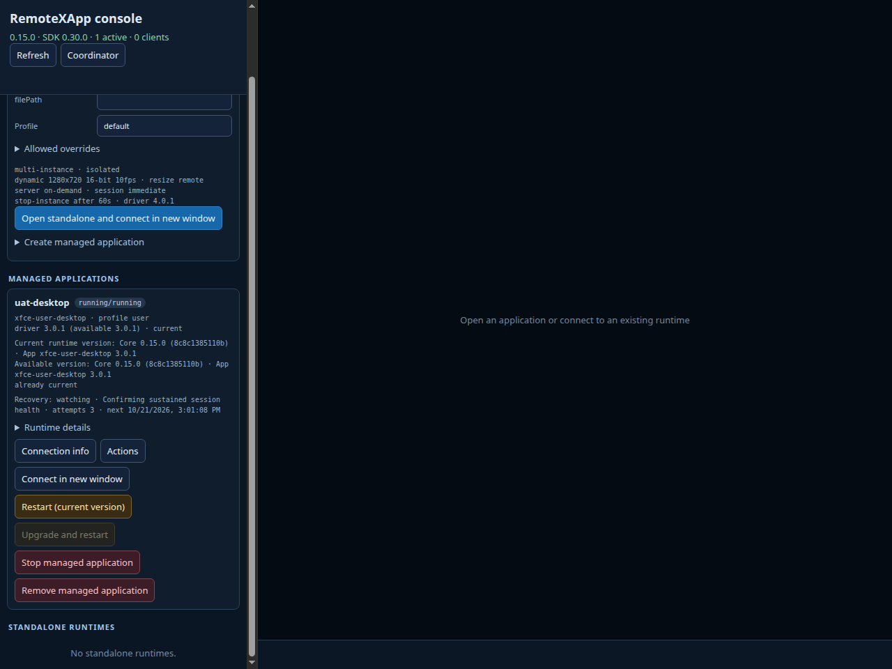

# Managed recovery 0.15.0 qualification

Automated qualification passed on 2026-10-21. The exact candidate is installed
for human UAT; acceptance and publication remain pending in
[Issue #3](https://github.com/woodegg/remotexapp/issues/3).

## Selected immutable candidate

- Core 0.15.0 / SDK 0.30.0; App versions unchanged.
- Source: `8c8c1385110bbe37381968340528dc4c0160fe86`.
- Archive: `remotexapp-0.15.0-linux-amd64.tar.gz`.
- SHA-256: `f7082814a9f7d797931705a5b8ca56fe7f7e00b2cdf276b7c44a11b53c52d13a`.
- [Hosted candidate run](https://github.com/woodegg/remotexapp/actions/runs/39655833914)
  passed with Go 1.27.3 and Node 22.23.3. Checksums, v1 evidence and the clean
  VCS identities of all four binaries were verified after download.

This documentation follow-up does not change the candidate. Any later tag for
this accepted artifact must identify the source above, rather than a newer
documentation commit. Publish those accepted bytes without rebuilding.

## Automated results

| Scope | Result |
| --- | --- |
| Exact archive: ABI/install/update/rollback and all shipped Apps | Passed |
| Exact archive: document connections, KDE/managed upgrades and Console/SDK actions | Passed |
| Exact archive: user-home managed recovery, session-services faults and boot matrix | Passed |
| Ubuntu 24.04 systemd | Manager adoption, two actual container reboots, health reset and process protection passed |
| Ubuntu 24.04 standalone/runit | Same checks passed under systemd host cgroup delegation |
| Ubuntu 26.04.1 systemd | Same checks passed |
| Served UAT Viewer and SDK | Connection, reconnect without generation change, fixed framebuffer and SDK 0.30.0 passed |
| Served Console | Recovery projection and candidate identity passed |

The eight exact-archive suites used the selected downloaded bytes. Source
verification also passed the required CI, focused lifecycle tests, race tests,
coverage floors and vulnerability scan. Each environment preserved identity,
locked Core/App versions, persistent HOME/document and borrowed account bus
across the applicable restart/recovery checks.

Each environment rebooted first with a failed record and then with a running
previously recovered record: persisted attempts advanced 1 → 2 → 3 and the
second boot retained its cooldown. These are six actual container restarts
with changed boot IDs, separate from the E2E boot-marker simulations.
They do not establish physical power-loss behavior or support for a host with
a non-systemd PID 1.

All three environments observed the full health interval and reset attempts
to zero with a success timestamp. A visible editor and live XFCE with
unverified readiness remained protected; guarded recheck neither killed them
nor charged another attempt. After explicit disposable-fixture cleanup,
background recovery resumed without a Viewer. This live fixture did not kill
the XFCE leader; deterministic tests cover the dead-leader/surviving-child
branch, while live E2E covers the empty-session leader-loss branch.

## Qualification history and retries

The earlier `0593b4e6ba741fadba386d688673b567630bcca0` candidate was rejected
when the second standalone reboot retired pending recovery prematurely.
[Issue #18](https://github.com/woodegg/remotexapp/issues/18) corrected monitor
ownership; [Issue #20](https://github.com/woodegg/remotexapp/issues/20) corrected
the first creating snapshot's legacy counter projection. All final checks
above used the replacement archive, including repeated actual reboots.

The first document run hit an external LibreOffice UNO timeout. The complete
document suite then passed on unchanged candidate bytes. A standalone health
helper's external stopwatch started later than the Manager's observation and
asserted elapsed time too early; rechecking after the remaining interval
passed health and process protection. Neither retry changed the product or
shortened its health interval. Initial diagnostic records were retained
privately alongside the successful results.

## Human UAT handoff

Follow the [UAT procedure](managed-recovery-0.15.0-uat.md). The private handoff
provides a loopback entrypoint and archive location. Existing deployments
remain with their owning project. Schema-3 state requires the rollback
procedure in the [release design](managed-desktop-self-recovery-release.md);
older Cores cannot read it directly.

The screenshot captures the selected candidate after reboot qualification,
before the later health-reset and protection checks. Attempt counts may
change during normal observation; use the live Console for current state.

[Structured automated evidence](../tests/evidence/v1/managed-recovery-0.15.0-exact-candidate.json)
records the artifact identity, scope and limitations. It is not human acceptance.
