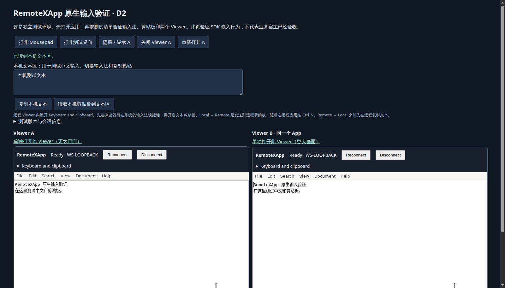

# D2 native input and text clipboard checkpoint

Issue [#32](https://github.com/woodegg/remotexapp/issues/32) and Draft PR
[#33](https://github.com/woodegg/remotexapp/pull/33) track this bounded checkpoint.
The default provider remains TigerVNC. The candidate is development software,
with native WSS, keyboard policy and explicit text/plain clipboard enabled only
in a project-owned disposable fixture. This is not a release or full D2 acceptance.

## Automated verification

See [dated results](results-d2-20261028.json). Real Chromium tests use Mousepad
file readback and native X11 clipboard readback; protocol connection alone does
not count. The matrix covers explicit bidirectional text, no passive local
write, empty read versus clear, 64 KiB UTF-8 bounds, denial, consent/reconnect,
four synthetic shortcut profiles, outside/inside focus cycles and independent
Viewers. Raw malformed messages test server rejection before clipboard mutation.
Two lifecycle backends retain pins/policy/processes on Manager restart. A host
harness tests base-path routing and iframe hide/show/dispose/recreation.

The harness is not the actual host application's business acceptance. Synthetic
CDP composition does not exercise an OS candidate window or physical shortcuts.
HTML/PNG/RTF/files, programmatic text with acknowledgement, audio and UDP are
outside this checkpoint. Physical browsers and operating systems remain pending.

The handoff page presents two independent Viewers of one App:



## Reproduce the browser matrix

Use only a dedicated CDP browser, loopback authenticated ingress and a newly
provisioned disposable fixture. Install real Apps, `xclip`, CJK and emoji fonts.
Build the paired component using the reconstruction recipe. Explicitly select
`-native-clipboard` on the Manager; keep all upstream listeners host-local.
Run dynamic-display Apps sequentially across Managers with overlapping pools.

Create a Mousepad instance opening a synthetic document under the configured
`document-roots`. Immediately open its native kiosk in the dedicated browser;
the ordinary 60-second vacancy policy remains active. Save its descriptor and
this configuration privately, outside the repository:

```json
{
  "purpose": "remotexapp-d2-disposable",
  "container": "remotexapp-d2-fixture",
  "user": "d2-user",
  "cdpURL": "http://127.0.0.1:23023",
  "managerURL": "http://127.0.0.1:23001",
  "ingressURL": "https://127.0.0.1:23002",
  "basePath": "/rx",
  "identityHeader": "X-RemoteXApp-Test-User",
  "identity": "d2-fixture",
  "documentFile": "/home/d2-user/documents/test.txt",
  "instanceFile": "/var/tmp/d2-private/instance.json",
  "xauthority": "/home/d2-user/state/profiles/mousepad/default/INSTANCE/.Xauthority",
  "evidenceDirectory": "/var/tmp/d2-private"
}
```

The helpers use Node 22, Python and the fixture's `lxc exec`. The name checks
reduce accidental targeting; they do not grant authorization. The tests replace
only the configured synthetic document and the dedicated browser's clipboard.
Run sequentially, with the selected Viewer still connected:

```sh
node tests/kasm-native/browser-text.mjs /var/tmp/d2-private/config.json
node tests/kasm-native/browser-wire.mjs /var/tmp/d2-private/config.json
```

`uat.html` is a test host, served by a separate fixture ingress. Its private
`/fixture-config` supplies `baseURL`, `documentFile` and `managedId`. The ingress
owns authentication and forwards the Manager under that base path. Never expose
an identity-injecting fixture proxy to an untrusted network. Use authenticated
TLS, or an SSH forward to a loopback listener and a localhost browser context.
Localhost's secure-context exception is not public HTTP deployment guidance.

## 人工 UAT（用户验收测试 / User Acceptance Testing）

记录实际运行浏览器的操作系统、浏览器版本、输入法名称，以及测试结果。若通过另一层
远程桌面访问浏览器，要分别记录两端系统。测试环境只使用临时测试文本。

1. 打开测试页，选择 **打开 Mousepad**。两个 Viewer 都应显示 Ready；可使用
   “单独打开此 Viewer”获得更大画面。展开 **Keyboard and clipboard**，选择浏览器
   所在系统：Windows、macOS、Linux GNOME 或 Fcitx。未知 Linux 不自动猜测快捷键。
2. 输入中文、英文、标点和 emoji；候选期间退格、选词、取消，再输入。重复之前故障
   路径：离开 Viewer → 在外面切换英文 → 返回 → 切回中文。再试先在外面切回中文
   后进入 Viewer。确认没有拼音残留、漏字、重复字或卡键。
3. 使用真实输入法切换键：Windows Win+Space；macOS Control+Space（按实际系统
   配置）；GNOME Super+Space；Fcitx Control+Space。确认本机输入法切换，远端没有
   多余空格、菜单或桌面动作。普通 Ctrl+A/C/V/S、Shift 选区和鼠标操作仍应正常。
4. 勾选 **Enable text clipboard actions**。本机复制多行中文 → **Local → Remote**
   → 点击远程正文按 Ctrl+V。远程 Ctrl+C → **Remote → Local** → 粘贴到本机文本区。
   远程复制本身不应覆盖本机剪贴板；空本机读取不应清除远端，清空需显式按钮。
5. 分别在 A/B 开关剪贴板，隐藏/显示 A、关闭/重建 A，确认 B 和应用继续工作。
   Reconnect 后应重新同意剪贴板。首次权限提示允许和拒绝各测一次，拒绝应显示失败。
6. 用 **打开测试桌面**重复重点输入和焦点切换。反馈通过/失败，并给出最短复现步骤；
   单个平台通过不等于所有平台通过。

这里需要人工操作，是因为自动化不能代表真实 OS 输入法、候选框和系统保留快捷键。
收到该候选的结果后，再记录 UAT 范围并推进评审；合并、完整 D2、发布与部署分别验收。
