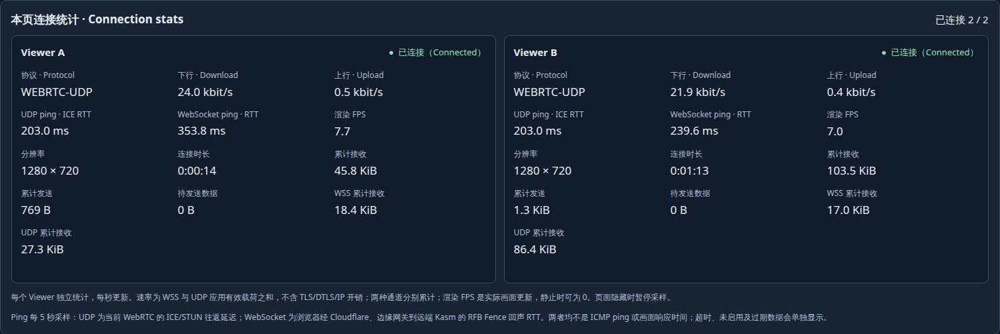

# Per-Viewer UDP and WebSocket latency

The owner's 2026-10-31 request adds two independent ping readings to the UAT
connection cards and native Viewer header. This continues Issue #36 / Draft
PR #37. The [2026-11-01 UTC result record](results-latency-20261101.json) identifies
the exact development artifacts installed in the Australia and China fixtures.
This is a focused latency qualification, not a formal release or a repeat of
every earlier UDP experiment.

| Reading | Measurement |
| --- | --- |
| UDP ping / ICE RTT | The active WebRTC connection's selected candidate-pair STUN round-trip time, in milliseconds |
| WebSocket ping / RTT | A correlated RFB Fence request and echo over the existing WSS connection, through the trusted edge to Kasm |

The Viewer requests a sample at most once every five seconds while its document
is visible. Reading SDK statistics does not start probes. UDP collection reads
browser-managed ICE measurements; it does not force an extra UDP ping. Repeated
reads of the same STUN response do not refresh the observation age. Values older
than ten seconds are hidden. Missing, pending, inactive, timed-out and expired
measurements have distinct states; disconnect and reconnect retire old work.
These are neither ICMP ping nor input-to-paint latency. A connected ICE peer
without actual UDP screen transit is not presented as an active UDP measurement.

Fence probes carry no input events, do not update Kasm user-activity timestamps,
and do not renew App idle leases. Candidate addresses and raw RTCStats are not
exposed by the SDK snapshot. Existing UDP forwarding, source restrictions and
Cloudflare routes were retained.

## Verified candidate

Core, trusted edge and component source are `4bdc54a2cae6`; the component manifest
is `fbf9280720f5…`. The native server binary is byte-identical to the preceding
qualified server. New client code is packaged under a new immutable manifest.
All four Core executables and the fixture ingress/edge are static builds.

- Focused tests passed 24/24; applied component tests passed 48/48. Full
  `make check`, SDK/Go coverage gates and
  [implementation CI](https://github.com/woodegg/remotexapp/actions/runs/41255171785)
  passed. Tests cover correlation, zero RTT, timeouts, stale UDP observations,
  late responses, peer retirement, unsupported data and cleanup.
- A dedicated Linux Chrome exercised two Viewers sharing a managed desktop in
  each region. Both had actual UDP frame counters and finite independent RTTs;
  selected ICE reports and emitted Fence requests were checked independently.
  A temporary changing display supplied traffic for actual UDP paint checks.
- Turning off A's UDP preserved its WebSocket measurement and B's UDP. A's
  disconnect cleared the UI; reconnect advanced A's connection epoch while B's
  epoch stayed unchanged. Real browser tab hiding stopped active Fence probes;
  returning restored sampling. Both cards and native headers displayed results,
  with no JavaScript exceptions in either successful run.
- Installation verification checked 21 Core files and 45 component files per
  region, plus all configured edge assets. Saved document hashes were unchanged.
  Only the managed runtime remained active, with no failed runtimes or attached
  test Viewers after cleanup. Owned animations, browser tabs and the isolated
  browser/cookie profile were removed; the local builder was stopped. Private
  rollback snapshots and immutable artifacts are retained.

Example observed readings were UDP 203 ms / WSS 239.6 ms in one Australia Viewer,
and UDP 221 ms / WSS 273.6 ms in one China Viewer. These are individual samples
from this test path, not regional benchmarks or latency guarantees.

## Retained failure and reproduction

The first client candidate (`4cfcad1`, manifest `d67f9ee9ece7…`) failed live UAT:
using browser timer functions as object methods caused `Illegal invocation` and
left the probe pending. Node tests with injected timers did not enforce the
browser receiver contract. Timer closures, a receiver regression test and real
Chrome verification resolved the issue before the final two-region run. The
failed candidate and raw evidence hashes remain in the result record.

To repeat the focused checks, use an authenticated dedicated browser/profile
against a project-owned UAT fixture with the exact artifact pins. Open the test
desktop, provide temporary changing pixels, and wait for both Viewers to report
actual UDP paint and both RTT values. Disable/re-enable UDP only in A, then
disconnect/reconnect A; confirm B remains independent and A clears old values.
Switch to another real browser tab for more than five seconds and verify no
new owned Fence probes while hidden. Return and confirm fresh readings. Close
only owned test resources and compare saved documents and installed hashes.

This run did not repeat the full previous network-fault, input/clipboard,
reboot or long-duration matrix on the new client pin. Physical OS input,
other browser engines, audio, file clipboard, business-host integration and
production release qualification retain their existing separate gates.
