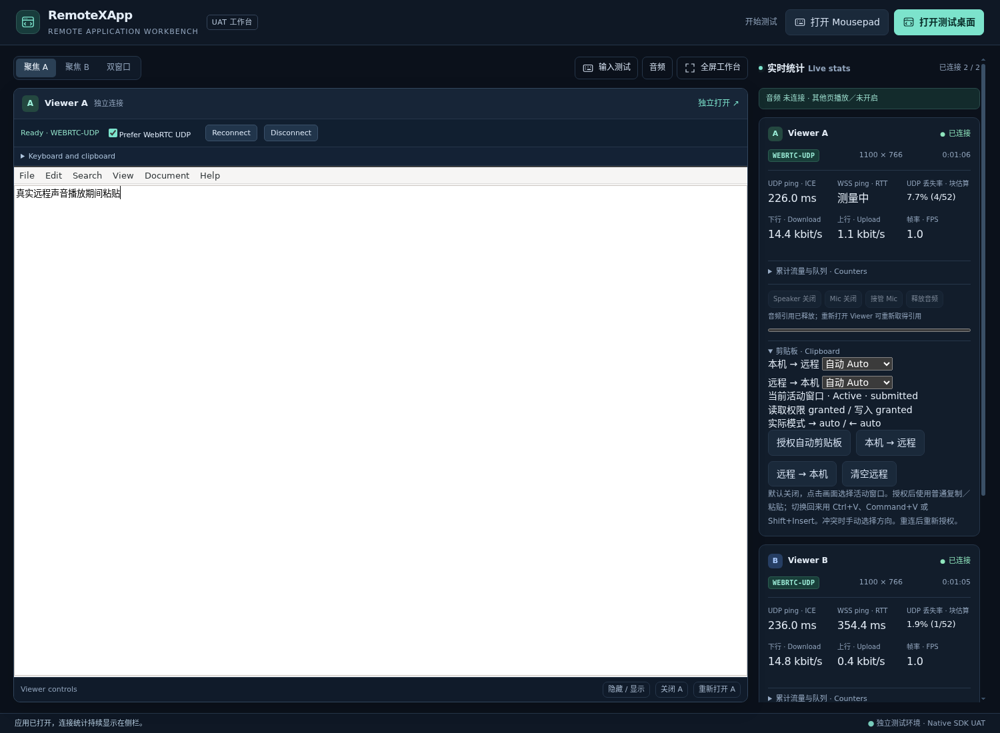

# Native automatic text clipboard qualification

Issue #50 / Draft PR #54 implements the KNC-001–008 contract. This checkpoint
qualifies a bounded standalone candidate; physical end-to-end UAT, actual
embedding-host integration, merge and publication remain separate gates.
Use the [single consolidated UAT checklist](NATIVE-CLIPBOARD-UAT.md).

## Candidate identity

The exact manifests, archive hashes, source revisions, case results and private
log digests are in [the sanitized result record](results-native-clipboard-20261102.json).
Do not substitute a later PR head or a post-merge build for these artifacts.

| Part | Qualified source / version |
| --- | --- |
| Core and SDK | `76479e5ad098ff13d6c0fa754973336e73d354d0`; Core 0.16.0-dev.5, SDK 0.31.0-dev.5 |
| Native server/client pair | `a427d647997aa3782203bf98c719f15f74b01f58`; separately pinned amd64 and arm64 manifests |
| Alpine Mousepad fixture | `0880f29c89c9791f9bac14142d6276b2577d8728`; immutable App package 1.0.3 |
| Existing audio test App | 1.0.1; retained accepted package bytes, not rebuilt with clipboard work |

Later test/report-only commits do not change those runtime identities. The
three project-owned public UAT sites use authenticated TLS through their edge
routes. Australia and China use amd64; US uses arm64. Existing App versions,
processes and document hashes were preserved. Newly launched Apps select the
new component and fixture. UDP forwarding and audio transport are unchanged.

## Behavior and adaptations

The SDK owns independent off/manual/auto directions, explicit consent and
permission handling, focused Viewer selection, bounded state, conflicts and
asynchronous retirement. Kasm's native clipboard messages remain the only
remote data path. Its full-page seamless clipboard hooks stay disabled so they
cannot compete with SDK ownership. The adapter orders native paste keys after
a fresh bounded clipboard submission. No legacy clipboard bridge is added.

Remote PRIMARY selection remains local (`SetPrimary=0`, `SendPrimary=0`),
separate from explicit CLIPBOARD copy/paste. Otherwise receiving local clipboard
text can destroy the remote editor's selected replacement range.

Plain UTF-8 text is bounded to 64 KiB; empty reads do nothing and clearing is
explicit. Reconnect requires fresh consent. An already-started uncertain write
is reported without replay. Public snapshots and UAT exports contain no text.
Clipboard uses reliable control traffic whether display is WSS or WebRTC UDP;
it neither owns nor requires an audio connection.

## Automated coverage

All browser checks used owned disposable profiles and synthetic text/audio.
The authenticated user browser supplied scoped Access sessions; its clipboard
and real microphone were not used. Local browser: Linux Chrome 149.0.7827.102.
Public browser: isolated Alpine Chromium 156.0.8078.79.

| Check | Evidence and scope |
| --- | --- |
| Standalone clipboard, 15 cases | Actual editor save and browser readback; Chinese/emoji/multiline, both directions, tabs/two runtimes, ownership, conflicts, empty/boundary/oversize, permission revocation, delayed operations, reset and reconnect. `browser-clipboard.mjs` |
| Embedded workbench, 9 cases | Actual A/B consent/activation, hidden Viewer, audio coexistence, visible statistics and untouched human acceptance rows. `browser-clipboard-workbench.mjs` |
| Input ordering, 24 checks | 20 coalesced click/select/paste batches, Open/Save As dialogs and context/File menus. `browser-input-order.mjs`; menu observation requires Python Xlib in the owned fixture |
| Manual/IME regression, 14 cases | Existing explicit clipboard, bounds, denial, four synthetic OS shortcut profiles and ten outside/inside composition cycles. `browser-text.mjs`; synthetic composition is not a physical IME pass |
| Public AU/CN/US, 9 cases each | Exact candidate/App, actual bidirectional text, painted UDP frames, WSS fallback/recovery, independent Viewers, speaker plus synthetic mic, remote Pulse tone detected in browser audio, and clipboard after all audio stops |
| Public rapid A/B switching | 40 consecutive China paste/save replacements on the corrected fixture; actual file contents checked on every iteration |

The public checks used served workbench/SDK/component assets. Only fixture
configuration was redirected to a uniquely owned temporary document. Browser
permission overrides and synthetic microphone input were explicit test setup.
UDP success required received display bytes and painted frames, not just ICE
connection state. Speaker success required a remote 440 Hz Pulse source to be
detected in browser PCM; a transport-open indicator alone was insufficient.

Temporary public test Apps were stopped and their owned documents removed.
Original documents and non-Manager process identities were verified unchanged.
Owned browser profiles, including imported authentication sessions, were removed;
disposable browser/fixture containers and both builders were stopped. The three
regional UAT sites and their rollback assets remain available.

## Failures found and bounded correction

A minimal Openbox configuration without a mouse section inherits content-click
bindings. Under coalesced pointer press/release and Ctrl+A, its synchronous
pointer grab allowed keyboard delivery with a stale Button1 state. The editor
then appended pasted text instead of replacing the selection. The old fixture
failed the first deterministic batched replacement; passive X11 observation
confirmed the incorrect state. Two queue-draining Kasm experiments did not fix
it and were excluded. Removing the window manager diagnostically passed, and
keeping Openbox with explicit `<mouse/>` also passed. Package 1.0.3 adopts that
single-App configuration; dialogs and menus are included in regression checks.
This does not qualify arbitrary desktop window-manager policies.

Earlier public runs also exposed harness errors (remote command invocation and
an unsaved text mutation used to generate UDP frames); those failed attempts
are not counted as passes. An older isolated Chrome/network setup did not
establish working UDP and is excluded; no specific network root cause was
proved. The final public results use the stated Chromium 156 environment.
A 64 KiB unbroken CJK line stalled the editor's layout during an earlier test;
the final automatic boundary test uses the same byte count with bounded lines.
Neither this checkpoint nor the manual boundary pass is an editor throughput
or long-duration resource claim.

## Remaining acceptance boundary

First-run permission UI, native Windows/macOS/Linux IME switching, physical
copy/paste from other applications, actual hearing/microphone quality and the
owner's normal browser require the consolidated human test. Chrome permission
overrides, synthetic OS profiles and generated audio cannot establish them.
Other browser engines, actual embedding-host/workspace integration, rich text,
images, files/directories, drag-and-drop, long-duration soak and post-merge
immutable release qualification remain unverified by this checkpoint.
