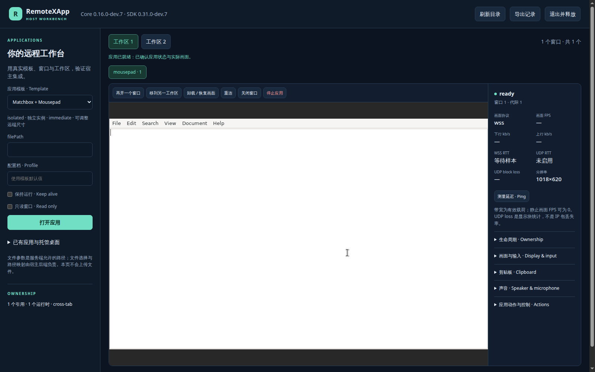

# Native host candidate qualification

Issue [#57](https://github.com/woodegg/remotexapp/issues/57), PR
[#58](https://github.com/woodegg/remotexapp/pull/58), measured 2026-11-03.
This qualifies a development candidate for the [consolidated UAT](NATIVE-HOST-UAT.md),
not a release, default-provider cutover or downstream application acceptance.
The previous standalone audio/clipboard UAT does not accept this new host layer.

## Candidate identity and scope

Production source: `4490361c699242bb88b74bc6daf861d6dffbbc4e`.
Core `0.16.0-dev.7`, SDK `0.31.0-dev.7`. Later test/documentation commits
reference these exact artifacts; they do not replace their identity. The managed
desktop catalog fix below separately identifies its updated workbench modules.
[Machine-readable results](results-native-host-20261103.json) retain Core,
component and App digests, archive hashes, scoped checks and evidence hashes.

| Fixture | Coverage | Browser |
| --- | --- | --- |
| Ubuntu 24.04 AMD64, systemd, separate non-root account | Eight formal templates; full host, channels, recovery, real reboot, veto and Manager rollback | Isolated Chromium 149; synthetic capture |
| Alpine AMD64, standalone/runit, two regional fixtures | Static Core, authenticated public host, real UDP/WSS, preserved prior Apps/documents | Isolated Chromium 156; synthetic capture |
| Alpine ARM64, standalone/runit, third regional fixture | Same regional behavior on ARM64 | Same isolated Chromium 156 |
| Protected full-template ingress | Eight-template public host, real WSS paint; anonymous requests redirected to Access | Isolated Chromium 149 |

The Ubuntu component uses the same native input/client source as the candidate;
its independently built manifest is recorded separately from Alpine components.
The native Kasm server pins are unchanged. This is bounded functional evidence,
not a benchmark or a new eight-hour soak result. Full eight-template availability
is demonstrated on Ubuntu; the regional Alpine catalog is intentionally narrower.

## Automated evidence

| Area | Result and practical meaning |
| --- | --- |
| Host UI | 8 checks: template form, Unicode save, duplicate windows, workspace retention, unload/restore, independent task ownership, read-only display, responsive layout and logout |
| Formal templates | 8/8: Mousepad, Kate, KWrite, LibreOffice, Edge, Firefox ESR, LightView, managed XFCE; actual paint and control/file readback |
| Shared channels | 11 checks: two sessions/three Tabs, one measured speaker graph and synthetic mic capture, independent routing, no implicit channel, unload continuity, all-off cleanup, text/HTML/PNG both ways, exact 2 MiB boundary and focus ownership |
| Lifecycle | 8 checks: document-root rejection, Manager adoption preserving processes/pins/account bus, reconnect permission reset, resize/hidden view, stale-generation rejection, live-child preservation, empty failed-session recovery and durable explicit stop |
| Actual reboot | Two real container restarts: running managed intent/pins/saved HOME data restored with a fresh generation; explicit stopped intent stays stopped |
| Explicit veto | Separate real-App fixture refuses normal stop; display/generation/processes remain, and owner release never becomes force |
| Scoped rollback | Prior immutable Manager `b1c4385fdb869a3155b6ef437e1aa8d6405e757f` adopts the pinned current App without changing processes/data; restored candidate reattaches and saves |
| Public host | 9 checks in each regional fixture: authenticated catalog, exact artifact, actual paint/input/save, native control descriptor, UDP/WSS transitions, read-only second owner and cleanup |
| Prior standalone workbench | 9 checks per region: automatic text clipboard, two-Viewer focus, UDP/WSS fallback, synthetic mic and measured remote speaker delivery |
| Delayed fixture launch | A 16-second injected delay remains within the new 60-second request budget; both Viewers paint after actual App creation |

Rollback is Manager-only. It does not downgrade pinned runtime components or
promise the new Host API/read-only contract on the old SDK/Core. Restore the
candidate before using those new APIs. No sandbox or downstream deployment was
used for fault injection.

Repository gates and their exact completion results are in the JSON. Deterministic
SDK tests cover bounded retry/exhaustion, cancellation, authorization refusal,
late async completion, stale ownership and no input/action replay. Go/native
wire tests exercise direct read-only writes, bounded parsing and exact-generation
stop rejection. A public browser success alone is not used as proof of those
server boundaries.

## Managed desktop catalog regression — 2026-11-03

Human UAT found that selecting Openbox in the template form returned HTTP 409.
The workbench submitted an ordinary instance creation for a `user-home` template;
Core correctly requires a registered managed target for that run mode. The
earlier desktop probes used `managedId` directly and missed this UI entry point.

Workbench source `899a71f` resolves a unique, running managed registration at
click time and attaches using `managedId`. Missing, ambiguous, stopped or unready
registrations produce an actionable message. The template button never registers,
starts or restarts a desktop. Parameters and profiles remain the managed
registration's configuration. Ordinary template launches keep their existing path.

[Regression evidence](results-native-host-managed-20261103.json) separates the
local browser's synthetic negative responses from real running-desktop
attachments through the four authenticated UAT entries. Each public check clicks
the template button twice, observes actual paint in both Viewers, verifies the
same instance/generation, and confirms no ordinary creation or managed-state
mutation request. Tests release only their own attachments. This verifies the
reported launcher defect; it does not renew the prior UDP, audio or clipboard
qualification or accept human UAT.

The update changes two static workbench modules. New edge listeners serve those
assets while existing listeners retain active connections. Core, native runtime
components, desktop desired state and Access verifier requirements are retained.
Open a new workbench Tab to load the fix without disrupting an existing editor.

To reproduce the local regression, run `node tests/kasm-native/browser-host-managed.mjs
<owned-fixture.json>` with the existing fixture contract and an already running
`host-desktop`. Negative states are intercepted HTTP responses confined to the
isolated test page; the real desktop is never stopped for this probe. Public
verification also requires an unexpired Access login and live UAT ingress.

## Findings and limits

- Native App descriptors legitimately report IBus `unsupported-provider`; the
  new SDK validator accepts that reason while rejecting inconsistent metadata.
- The read-only proxy must preserve the validated upstream Host and Origin.
  Actual painted read-only attachments and direct-wire rejection are both tested.
- The disposable ingress initially referenced HTML under `/tmp`; real reboot
  removed it and broke the test entry. Moving fixture content to persistent
  storage fixed the harness. Both reboot results are from the corrected run.
- Two short action tests exceeded their one-second budgets during parallel
  native compilation. Five isolated repeats and the complete quiet `make check`
  passed. The failed attempt is retained in evidence, not silently counted as a pass.
- An initial standalone UAT launch did not reach Viewer setup; full reruns passed.
  Its 15-second client deadline was shorter than template startup budgets. The
  fixture now waits up to 60 seconds, verified with a 16-second injected delay.
  This identifies a request-budget defect, without claiming the first failure's
  exact cause from incomplete browser diagnostics.
- Clipboard permission, microphone capture and local IME remain browser/user
  decisions. Synthetic audio verifies routing/sample delivery, not physical
  hardware, perceived quality or actual OS candidate-window behavior.
- This work uses only public SDK calls for host operations. Control probes run
  locally on owned fixtures for CDP/BiDi/UNO/D-Bus/socket readback. The host's
  file mapping, durable product window restoration and trusted executor still
  need downstream adaptation.

## Reproduction and handoff

Live scripts require an owned disposable fixture with the eight installed App
packages, persistent ingress/content services, allowed document roots, non-root
account bus and an isolated Chromium CDP. The private fixture config consumed by
`host-browser.mjs` rejects unexpected account/container/origin scope. Never use
these fault-injection scripts against an existing user's active session.

Run the `browser-host-{workflows,templates,channels,lifecycle,boot,rollback,veto}.mjs`
suites sequentially with that fixture config. Rollback additionally requires a
checksum-verified prior Core; veto requires the separately packaged test hook.
Do not substitute a template name for proof that its shutdown hook vetoes.
Public ingress tests additionally depend on current Access login, DNS, edge
configuration and UDP forwarding. `browser-host-public.mjs` accepts an explicitly
owned HTTPS fixture, loopback CDP, exact source/component identity, a remote
command wrapper and an evidence directory. Private deployment records retain
those details. Browsers/profiles and both builders were cleaned up; UAT services
remain available. All three regional document inventories match their pre-update
hashes, with no owned test Apps or Viewers left connected.

The [migration guide](../../docs/native-host-migration.md) maps retained workflows
to new ownership/APIs. The [UAT checklist](NATIVE-HOST-UAT.md) is the single human
handoff. Merge, a post-merge immutable release candidate and publication remain
separate decisions.

