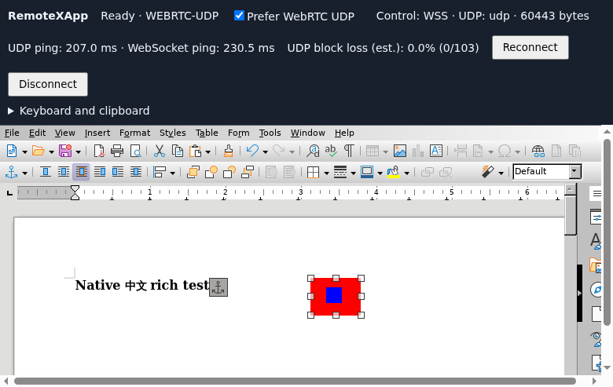

# Native rich clipboard qualification

Issue #55 / Draft PR #56 extends #54's native clipboard policy to plain text,
HTML and PNG. This is a development candidate, not a release or human UAT
acceptance. Use the [combined end-to-end checklist](NATIVE-RICH-CLIPBOARD-UAT.md)
for one physical pass covering both PRs.

## Exact candidate

The [sanitized result record](results-native-rich-clipboard-20261103.json)
contains archive and manifest hashes, case results, cleanup and limitations.

| Part | Source and identity |
| --- | --- |
| Core, SDK and test edge | `b1c4385fdb869a3155b6ef437e1aa8d6405e757f`; Core 0.16.0-dev.6, SDK 0.31.0-dev.6 |
| Workbench page | `24155a29deade6c82884f4e07081e6ba31639d2b`; separately pinned static page with the Writer startup timeout correction |
| Native server/client pair | `cc9f4a6877053d45884265a7ecaa88533cf2e127`; separate immutable amd64/arm64 component manifests |
| Writer test App | 1.0.0, source `cc9f4a6877053d45884265a7ecaa88533cf2e127` |
| Retained fixtures | Mousepad 1.0.3 and audio test App 1.0.1 retain their installed package bytes |

Later test/report commits do not replace those runtime artifacts. Australia
and China use amd64; US uses arm64. Deployment selected the new component for
new Apps. Existing running Apps retained their component pin, session generation,
process identity and documents. Expired stopped-instance records are not live
Apps and can be pruned by normal Manager retention.

## What is tested

All clipboard data and remote documents were synthetic. Browser profiles were
isolated; scoped authentication sessions were imported without using the user's
clipboard or physical microphone. Local Chrome 149 and public Chromium 156 ran
on Linux. Browser permission overrides do not test physical permission prompts.

| Suite | Coverage |
| --- | --- |
| Rich clipboard, 16 cases | Actual Writer HTML paste/copy with bold and Chinese; PNG dimensions and pixels; all three representations in one item; delayed/failed/timed-out and superseded X11 owners; INCR; aggregate limits; embedded NUL; file URI exclusion; normalization/no echo; empty no-op and explicit clear |
| WSS rich roundtrip, 2 cases | Actual Writer HTML and PNG in both directions with display explicitly set to WSS |
| Rich lifecycle, 7 cases | Automatic rich upload, same-runtime tabs, two runtimes, focused ownership, no background fan-out, inactive baseline, explicit source choice and reset |
| Public regression, 9 cases per region | Exact served candidate, text copy/paste, painted UDP frames, WSS fallback and UDP recovery, independent embedded Viewers, speaker/synthetic mic, remote Pulse tone detected in browser PCM, clipboard after audio disconnect |
| Old component compatibility, 15 cases | New Core/SDK with an actual old text-only component pin; Chinese/emoji, two runtimes, conflicts, permission revocation, delayed operations, reconnect, manual actions and the old 64 KiB boundary |

Rich clipboard remains on the reliable native control stream. UDP success was
checked using received display bytes and rendered frames during real rich
clipboard use, rather than just an ICE-connected label. The full public audio
regression used text; simultaneous HTML/PNG with physical audio belongs in the
combined UAT checklist.

The delayed-representation test records every browser clipboard write and
requires exactly one complete multi-format item. A fixed sleep after an SSH
fixture command cannot establish partial-state timing over a WAN. A new Writer
document and a fresh remote-copy notification prevent previous document or
clipboard contents from producing false positives.

## Failures and follow-up

- The initial workbench candidate registered rich sample buttons before its
  selector helper was initialized. `b1c4385` corrects startup ordering; subsequent
  page, embedded-Viewer and public tests use that exact corrected build.
- Australia Writer launch failures exposed a workbench deadline mismatch:
  the page canceled its request after 15 seconds while Writer allows 45 seconds
  for application readiness. A controlled 18-second dispatch delay reproduces
  cancellation on the old page. `24155a2` allows 60 seconds for Writer startup;
  the same delayed request then opens two ready Viewers in all three regions.
  The correction is a separately pinned page package; no Core/native binary,
  App pin or original process was changed for this follow-up.
- The US host's UDP proxy on the second test port accumulated queued datagrams
  while ICE failed. Recreating only that proxy with identical configuration
  restored actual UDP display traffic. Three subsequent fresh Writer cycles
  exercised UDP and WSS; both host proxy receive queues were then empty.
  This localizes the observed interruption to the forwarding path; it does not
  establish the internal proxy defect or prove automatic recovery/long-term
  stability. The container and the first proxy were not restarted.
- One US WSS HTML readback contained the expected text but lacked bold. Fresh
  Viewer, same-Viewer, explicit-clear and fresh-App repetitions subsequently
  passed without a runtime change. Its trigger remains unestablished. Keep this
  observation open in Issue #55 and explicitly repeat alternating plain text,
  HTML and image paste during physical UAT; do not call it a verified fix.
- A China delay assertion initially assumed fixture RPC completion preceded a
  one-second injected delay. Recording actual writes replaces that timing
  assumption; the subsequent run verifies atomic publication directly.

The original failure results remain in private evidence, with digests in the
sanitized record. Passing later attempts does not erase those observations.

## Remaining gates

Human acceptance remains pending, including the open formatting observation,
real clipboard prompts, physical OS input-method shortcuts, real microphones
and audible playback. Actual embedding-host/workspace behavior, other OS and
browser combinations, and a new long-duration soak are outside these runs.
RTF, arbitrary MIME, file/folder copy and drag-and-drop are excluded features.

Keep #56 stacked on #54 until its dependency is merged. Merge, qualification of
the exact post-merge candidate, immutable publication and downstream deployment
remain separate steps. No release tag or acceptance is implied by this report.
