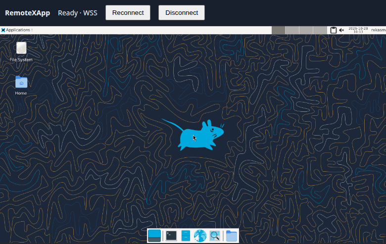

# Native Kasm qualification

**2026-10-31 correction:** the earlier D1/D2 click-then-type checks did not prove
remote pointer delivery. Physical UAT found missing pointer initialization, and
the expanded matrix also found a multi-Viewer encoding-cache defect. The original
D2 candidate is UAT-failed. See [the corrective checkpoint](D2-UAT.md#2026-10-31-input-correction)
for replacement evidence and the remaining physical UAT gate.

The next bounded input/clipboard checkpoint is recorded in
[D2 automated evidence and physical UAT instructions](D2-UAT.md). It does not
change the D1 scope or imply full D2 acceptance.

## D1 native WSS qualification

D1 exercises an opt-in paired Kasm component through the Manager and native
SDK. The default remains TigerVNC. Implementation acceptance is Issue #30;
publication, host application integration, physical IME/clipboard, audio, UDP
and performance qualification remain separate gates.

## 2026-10-28 implementation evidence

[Sanitized results](results-20261028.json) bind the live matrix to Core source
`3bc5aed0eceb5d5b19d1335c57f6d619a886091a` (Core 0.16.0-dev.1 / SDK
0.31.0-dev.1) and Kasm manifest
`7045b68a5fad52e9c77afecfc1eb76c6accd90fb98f57314e26a30faf9ace17f`.
Subsequent documentation/test-helper edits do not change those artifact
identities. [PR #31](https://github.com/woodegg/remotexapp/pull/31) owns review
and merge; Issue #30 owns implementation acceptance.

| Gate | Evidence |
| --- | --- |
| D1-01 pins/prerequisites | Verified source reconstruction, archive/patch/server/client digests and notices; missing/tampered/extra members and incompatible schema/provider rejected |
| D1-02 real startup | Mousepad and managed XFCE visible through native WSS; pointer/ASCII/save readback; App readiness plus real paint; bounded SDK startup/cancellation tests |
| D1-03 Viewer/access | Two Viewers, 30 reconnects, independent detach, final 60-second vacancy; identity/Origin/pin/generation/route negatives; real old-channel closure during recovery |
| D1-04 persistence/adoption | Both backends retain process identities, pins, HOME and borrowed bus on Manager restart; atomic-write, concurrent recovery and unknown-ownership tests |
| D1-05 recovery/intent | Both backends recover an empty failed desktop without a Viewer; persisted retry/cooldown tests; explicit stop/veto/upgrade controls; retired descriptor rejected |
| D1-06 surviving processes | Both backends retain a real editor after Driver/Supervisor loss and report blocked/unhealthy preservation; explicit veto fixture retains its Driver until authorized force |
| D1-07 reboot/data | Actual container restart, both backends, desired-running and explicit-stop cases; changed boot ID, stable pins/HOME/data, advanced generation and one display owner; real post-boot paint |
| D1-08 cleanup/rollback | Owned display sockets/processes gone; same-UID unrelated sentinel and borrowed bus preserved; prior immutable Core 0.15.0 / SDK 0.30.0 plus scoped snapshot restored and exercised |
| D1-09 regression | Default TigerVNC real browser readback/reconnect; focused tests, full check, race, CI coverage/vulnerability gates; sanitized evidence and limits retained |

The final fixture is stopped, its loopback ingress is closed, and private
raw evidence/disposable data are retained. No existing deployment was changed.
The screenshot shows the dedicated fixture after the actual reboot:



Two product defects were found and fixed before this final run: destructive
user-home descendant cleanup after unexpected Driver loss, and a Kasm receive
loop that stalled on completed control messages. The result file distinguishes
those defects from test-harness/fixture errors and records their regressions.

This is automated **D1 implementation** evidence. It does not qualify physical
IME, clipboard, audio, UDP, host workspaces, non-systemd PID 1, performance,
other browsers, distribution or a post-merge release. Human UAT remains
separate. The fresh source build used preinstalled build dependencies; complete
supply-chain/distribution qualification remains Issue #26. Supervisor-loss
health was checked after Manager restart, not as an immediate-detection SLA.

## Portable and component checks

Run `make check` and the relevant Go race tests. Native tests cover schema-4
identity, pin/asset mismatch, cross-provider upgrade refusal, generation-bound
prepare/attach, real WebSocket retirement, atomic-write failure, concurrent
recovery, persisted retry/cooldown, App readiness plus actual paint, cancellation
and disposal. Shared lifecycle tests cover occupied/unknown resources and
shutdown/upgrade intent. The real-process supervisor tests distinguish
unexpected user-home Driver death from clean logout and explicit stop.

`node --test third_party/kasm/tests/server-messages.test.mjs` tests every split
of the codec capability payload, coalesced messages and bounded count fields.
The applied upstream handler test needs `KASM_CLIENT_SOURCE`; the component
build runs it against the actual patched source. This test is intentionally
skipped by ordinary CI when that external build tree is unavailable.

Build the component using the [pinned reconstruction recipe](../../third_party/kasm/README.md).
Do not overwrite an installed component. Record its manifest digest, Core
commit/binary hashes, App Package digests, browser and lifecycle backend.

## Disposable live fixture

These tests require an explicitly owned disposable container, authenticated
loopback test ingress, real X11 Apps, a separate browser profile, and permission
to inject faults and reboot that fixture. They must never target an existing
user, UAT or sandbox deployment. This repository does not own those deployments.

Provision two independent non-root accounts/HOMEs/state roots/listeners and
nonconflicting fixed display allocations. Run transient Apps sequentially or
assign disjoint dynamic display/port pools to each Manager. One uses systemd; the other uses the
standalone backend in a delegated cgroup v2 subtree, with runit supervising only
the Manager. The measured standalone fixture uses systemd as the **host's**
delegation/bootstrap mechanism; it does not qualify a non-systemd PID 1 host.
User-home systemd sessions require systemd 250 or newer for `ExitType=cgroup`.
Provide each account's persistent D-Bus before starting its Manager.

Install the real Mousepad 4.0.1 and managed XFCE user-home 3.0.1 Apps. Keep their
activation/vacancy/shutdown contracts. A separate test-only App with an explicit
shutdown veto hook can exercise refusal; do not change the shipped Mousepad
no-save shutdown contract.

`fixture-control.py` accepts a private configuration file, for example:

```json
{
  "purpose": "remotexapp-d1-disposable",
  "container": "remotexapp-d1-fixture",
  "backend": "systemd",
  "user": "d1-systemd",
  "uid": 1001,
  "home": "/home/d1-systemd",
  "stateDir": "/home/d1-systemd/state",
  "managerURL": "http://127.0.0.1:22991",
  "identityHeader": "X-RemoteXApp-Test-User",
  "identity": "d1-fixture",
  "managedId": "d1-desktop",
  "managerRestart": ["systemctl", "--user", "restart", "remotexapp-d1.service"],
  "sessionCgroupRoot": "/sys/fs/cgroup/user.slice/user-1001.slice/user@1001.service/app.slice",
  "evidenceDirectory": "/var/tmp/d1-private-evidence/systemd"
}
```

The container-name/purpose checks guard against accidental reuse; they do not
replace authorization. This helper uses `lxc exec` against the selected fixture.
Set the standalone configuration to its own account, URL, root and
`["sv", "restart", "/home/d1-standalone/services/manager"]` command.

Create the configured managed registration first. Run actions **sequentially**:

```sh
python3 tests/kasm-native/fixture-control.py /var/tmp/d1-config.json start
python3 tests/kasm-native/fixture-control.py /var/tmp/d1-config.json snapshot
python3 tests/kasm-native/fixture-control.py /var/tmp/d1-config.json adoption
python3 tests/kasm-native/fixture-control.py /var/tmp/d1-config.json driver-loss
python3 tests/kasm-native/fixture-control.py /var/tmp/d1-config.json empty-recovery
python3 tests/kasm-native/fixture-control.py /var/tmp/d1-config.json supervisor-loss
python3 tests/kasm-native/fixture-control.py /var/tmp/d1-config.json stop
```

`driver-loss` starts a real editor in the exact session cgroup, kills only the
verified disposable Driver, and checks preservation, blocked replacement and
borrowed-bus identity. `empty-recovery` deliberately kills that owned component
and waits for no-Viewer recovery. `supervisor-loss` checks surviving applications
and unhealthy preservation (incomplete adoption health or populated-session
recovery blocked) **after Manager restart**; it does not claim
immediate supervisor-loss detection. `stop` verifies explicit stop and empty
owned component cgroups. Raw records go only to the private evidence directory.

## Browser, reboot and rollback matrix

Use a dedicated CDP browser and the authenticated Manager kiosk routes. For
both providers, require visible nonblank App pixels, pointer focus, ASCII/raw
shortcut input with saved-file readback, disconnect/reconnect and two-Viewer
independence. For native readiness, additionally assert App readiness and
current generation/component digest. Exercise final detach through the App's
actual vacancy policy and reject missing/invalid identity, invalid Origin,
stale generation, stale component, legacy input and upstream management paths.
Do not count an established WebSocket alone as a pass.

Before the **actual** container restart, persist one desired-running managed
registration and one previously active, explicitly stopped registration for
each backend. Store private boot ID, generation, component/HOME/App identities
and saved-file hashes. After restart, check a changed boot ID, unchanged pins
and data, one display owner, preserved explicit stop, and real Viewer paint.
An on-attach desktop should retain its activation policy: restoring the display
is distinct from starting its App session when a Viewer connects.

For scoped rollback, download and checksum-verify the prior immutable Core/SDK
archive. Use a third disposable account. Stop its App and Manager before taking
a state/profile snapshot. Exercise the new Core's default provider, then Kasm
in separate native state, then stop and restore the compatible prior Core/SDK
and snapshot. Recreate the disposable App against the retained document and
verify real pixels/input/readback again. Record the necessary downtime; this
is not live X-server adoption across providers. Never pass native schema-4
state to the prior Core or permit concurrent document/profile writers.

Keep raw protocol data, input/document contents, profiles, credentials, full
process records and private addresses out of public evidence. Summaries should
contain identities/digests, assertions, failures and explicit limitations.
