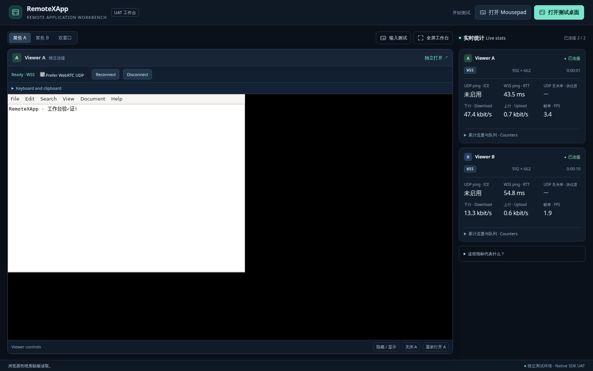

# Native UAT workbench

The native test page keeps the remote application and per-Viewer diagnostics
in the same viewport. This extends KNA-005 and Issue #36 / Draft PR #37. It
changes the UAT presentation, not the pinned Core, SDK, Kasm component or
transport measurement contract.

Focus A, focus B and side-by-side modes preserve both iframe nodes and their
connection identities. The inactive focus panel retains dimensions but is
inert and visually hidden. Fullscreen applies to the whole workbench, including
statistics. Explicit hide, close and recreate controls remain separate from
layout changes. No additional keyboard shortcuts are intercepted.

The stats rail shows protocol, resolution, duration, UDP/WSS RTT, display-block
loss, payload rates and measured FPS for each Viewer. Cumulative counters and
queue size expand on demand. Narrow screens move statistics below the remote
surface; phones offer A/B stats selection. The page itself does not scroll;
long diagnostics and input tools scroll within their own regions. Input and
explicit local clipboard controls expand without covering the statistics.

All values use the existing read-only snapshots and sampling cadence. Empty,
disconnected and unmeasurable states remain explicit. UDP loss still means
[observed display-block loss](UDP-LOSS.md), and RTT still follows the separate
[latency contract](LATENCY.md). The embedded Viewer receives presentation-only
styles; its original transport, keyboard and clipboard controls remain active.
Standalone Viewer pages are unchanged.

## Verification

[`browser-workbench.mjs`](browser-workbench.mjs) exports `checkWorkbench` for
an authenticated, owned CDP tab containing two Viewers of a disposable Mousepad
App. Supply target-side `readDocument` and an optional screenshot callback.
Never run its typing against a user's existing application or document.

The checks measure viewport/rail/metric geometry across eight desktop/tablet/
phone sizes, actual fullscreen, focus and comparison layouts, and expanded
input tools. They check retained iframe/epoch identity, pointer/Unicode/arrow
input with saved-file readback, local clipboard actions and denial, focus
return, independent close/recreate, and browser exceptions. Keep browser tests
serial: taking foreground with a second test can change visibility behavior.
Live checks depend on SSH, a target App and an authenticated browser.

## Deployment

Package this HTML under a distinct immutable page hash. Copy the already
qualified edge executable, SDK, Viewer and component assets unchanged; verify
each retained hash. Start the pinned edge configuration on a second loopback
listener and validate its response before changing only the protected UAT
hostname's tunnel destination. Preserve the Access requirements and all other
routes. Retain the preceding listener and its configuration for rollback. A tunnel
configuration update may still interrupt existing WebSockets; keeping that
listener alive does not guarantee continuity. Account for vacant-session
cleanup before scheduling a cutover. No runtime/App restart or Core/component
replacement is needed. Refreshing the UAT page loads the new layout.

The dated result record distinguishes page identity, retained runtime/component
identity, actual checks, rollout verification and cleanup. This UI check does
not repeat native transport qualification, physical OS IME acceptance or a soak.

## 2026-11-01 verification

Page source `ef126a3c80ef446eb7abe670a402bf8333c70e28` and HTML hash
`4eaed1fc49ac08b4a373b9616aae19d69ae02e24d83d35df7e7f9686005ad7e2`
passed 91 preview checks and 91 checks on each authenticated Australia, China
and US public UAT. All eight viewport sizes, fullscreen, layout identity, real
input/readback, clipboard allow/deny, and independent close/recreate passed.
`make check` and [source CI](https://github.com/woodegg/remotexapp/actions/runs/41268928044) passed.
The [result record](results-uat-workbench-20261101.json) binds exact hashes and
records the observed transport states and retained runtime identities.

The static HTML is identical in all three regions. Retained binaries, SDK,
Viewer and component assets matched their hashes; only the protected UAT
route destination changed. Australia/China existing process identities and
saved documents were unchanged. US Core and managed desktop remained running,
but its previously open editor lost its last Viewers five seconds after the
route update, then stopped under the existing one-minute vacant cleanup policy.
Its saved files were unchanged. This is evidence that a second listener alone
does not guarantee connection continuity across tunnel reconfiguration.

Owned temporary Apps were stopped, documents removed, and browser tabs/profile
cleaned up. The previous edge listeners remain available for rollback. These
results qualify the UI change; they do not repeat the transport fault matrix,
physical OS IME or other browser engines. US test traffic used WSS; Australia
and China also supplied live UDP statistics.

[Two-Viewer comparison](uat-workbench-split.png) ·
[Narrow-screen statistics](uat-workbench-mobile.png)

## Audio test preparation (Issue #47)

The audio drawer keeps the remote surface and statistics in view. Input and
audio drawers are mutually exclusive; opening input tools stops a local audio
probe. It is an extension of this test page, not the D3 product audio backend
tracked in [Issue #45](https://github.com/woodegg/remotexapp/issues/45).
The SDK still reports `audio:false`. There are no remote speaker/mic switches
or simulated mux connection counts.

1. Open Mousepad, then **音频 / Audio**. A and B initially show the same runtime.
   Choose **B → 测试桌面** for two different runtimes. A stays connected; choose
   **B → 与 A 同会话** to return. If A is already the configured desktop, both
   remain the same runtime and the page says so. Closing/reopening B uses its
   own selected target. An App can remain running after its Viewer closes.
2. Click **播放 1 秒测试音**. Only this browser generates the short quiet tone.
   Select heard/not heard yourself; finishing playback is not a pass result.
3. Click **检查麦克风** and grant or deny the browser request. A local RMS meter
   displays the input level for at most 30 seconds. The microphone is not
   monitored through the speaker, recorded or sent to a server. Stop/cancel,
   panel close, page hide/retirement and device loss release it. Waiting more
   than 15 seconds cancels the request logically; a later browser approval is
   immediately released and cannot restart capture.
4. Export JSON to keep local observations, runtime metadata and the pending
   remote acceptance checklist. It contains no device identifiers, media,
   endpoint/grant URLs or credentials. A local signal only means a local input
   level was detected. Automated fake devices cannot qualify physical hardware.

Runtime metadata comes from the Manager descriptor/readiness observation. It
is not a continuously verified audio-domain identity or proof that a Viewer
is attached to a particular audio generation. Viewer close/state remains
separately visible. Local observations belong to this browser page and are
not attributed to either remote App. The export has schema 1 and scope
`local-device-check-and-remote-checklist`; every remote case is `not-run` with
`backend-not-integrated`. No remote pass controls are provided yet.

Remote validation still needs real per-session playback/mic readback, first
on/last off/silence behavior, same-session multi-Tab ownership, explicit mic
targets/takeover, workspace references, revocation/fault cleanup and resource
checks. Physical devices and embedding-host integration remain separate UAT.
The short local probe stops when hidden; this does not define the lifetime of
future remote audio interests, which can persist across hidden workspaces.

`node --test tests/kasm-native/audio-probe.test.mjs` exercises the actual inline
probe with controlled media/clock dependencies. `make check` includes it. Browser
fixture verification and screenshots must distinguish simulated Viewer/media
results from live backend or physical-device acceptance. Deploy the HTML using
the existing immutable edge procedure above; refreshing an old deployed page
alone cannot load a file that has not yet been staged there.
