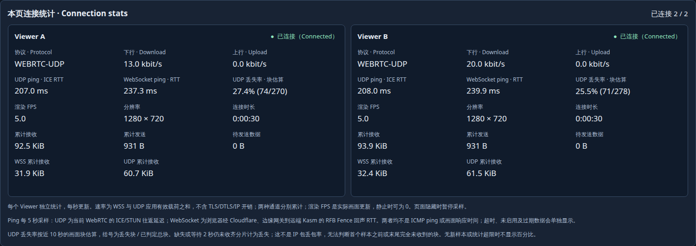

# Per-Viewer UDP display-block loss

The owner's request adds a UDP loss reading to the UAT connection cards and
native Viewer header. This continues Issue #36 / Draft PR #37. The reading is
**receiver-observed display-block loss**, not IP datagram loss or frame loss.
The pinned Kasm wire format supplies a block ID and fragment index/count; it
does not supply a global IP packet sequence or total sent-datagram counter.
The [2026-11-01 UTC results](results-udp-loss-20261101.json) bind the checks to
exact development artifacts; they do not qualify a formal release.

## Measurement contract

Each sender block ID represents a rectangle or flip marker. A block is received
when all unique fragments arrive. A gap between observed IDs, or an incomplete
block, counts as lost after a two-second reorder allowance. Duplicate fragments
do not increase counts; late arrivals do not reverse finalized loss. Sequence
arithmetic handles 32-bit wrap. The ratio is `lost / (received + lost)` across
the last ten one-second buckets of finalized blocks. UI text shows the percent
and `lost / total` counts separately for each Viewer.

The first observed ID establishes the baseline. Loss before that ID and wholly
unseen trailing loss cannot be inferred. An idle display becomes "no recent
samples" after ten seconds, rather than showing a fresh zero. Gaps or pending
observations beyond the 512-block budget, and inconsistent fragment metadata,
make the affected window unavailable. Disabling UDP, disconnecting or creating
a new peer clears or retires its measurements. These limitations mean this is
a diagnostic estimate, not an exact count of dropped network packets.

Tracking retains bounded header/bitset metadata, no extra payload copies or
timers. Reading stats is passive and adds no UDP or WebSocket messages. It does
not alter the decoder, retry/fallback policy, native server or transport format.
The existing [latency probes](LATENCY.md) retain their separate behavior.

## Reproduction

Use the exact immutable candidate in a project-owned fixture and an authenticated
dedicated browser profile. Open two Viewers sharing a disposable managed desktop,
provide temporary changing pixels, and wait for actual UDP paint, ready loss
samples and both RTT readings. Save the baseline.

Inject random receive-side UDP loss only for the dedicated browser's selected
flows, with a short kernel expiry and explicit cleanup. Retain rule counters to
prove real packets were dropped. Check both cards and native headers show a
positive block estimate while UDP continues painting. Remove the fault and
continue traffic beyond the two-second allowance plus ten-second window; verify
that the estimate recovers. The configured packet-drop percentage is not the
expected block-loss percentage: blocks may span multiple packets.

Disable UDP only in A; confirm A reports inactive while B continues. Disconnect
and reconnect A, checking old samples clear and only A's connection epoch
changes. Hide the page in a real background tab and confirm Fence probes pause.
Stop the temporary animation and wait for both cards to show no recent samples.
Close owned tabs/processes and remove only owned fault rules. Verify installed
hashes, preserved documents and retained deployment restrictions.

For a local receive-side fault, match the verified browser process's actual UDP
socket ports. A selected peer-reflexive ICE candidate can describe a NAT-mapped
port; copying it into a local input rule may match no packets. Require nonzero
drop counters before accepting the experiment.

## Verified candidate and attempts

Core, edge and component source are `51555cdba0a1`; component manifest is
`42a08c90bc19…`. The native server binary is byte-identical to the preceding
qualified server. Static Core/edge builds, 27 focused tests, all 55 applied
component tests, full `make check`, coverage gates and
[implementation CI](https://github.com/woodegg/remotexapp/actions/runs/41257185266)
passed. Unit tests cover gaps, partial blocks, duplicates, reordering, 32-bit
wrap, late fragments, stale data, bounded metadata and per-Viewer isolation.

Two Viewers shared one managed desktop in each region. Both kept painting over
UDP during the accepted receive-side fault. The rule dropped 211 actual
datagrams in Australia and 240 in China. These are sampled block estimates:

| Region | Before injection, A / B | During injection, A / B | After removal, A / B |
| --- | --- | --- | --- |
| Australia | 0% / 0% | 28.6% / 25.1% | 0% / 0% |
| China | 6.3% / 1.1% | 31.2% / 29.4% | 7.4% / 0.7% |

China retained nonzero observed block loss outside the injected fault. Its
origin was not isolated in this focused run; it is not a measured IP packet-loss
rate or a regional benchmark. Screenshots and JSON samples occur at different
instants within a rolling window, so their displayed values can differ.

Both regions passed independent UDP preference, disconnect clearing, fresh
reconnect epochs, hidden-page Fence probe suspension, idle/stale display, both
UI surfaces and zero browser exceptions in the accepted run. Verification
checked 21 Core files, 45 component files and every configured edge asset in
each region. Saved document hashes matched the immediate pre-activation backup.
One managed runtime remained per fixture, with no failed runtimes or attached
test Viewers. Owned fault rules, animations, tabs and the dedicated cookie
profile were removed; the local builder was stopped. Existing source policies,
routes and UDP forwarding remained in place.

The retained attempts include a sender-side firewall experiment that caused
WSS fallback and a receive-side rule that matched no packets because it used
NAT candidate ports. Neither was accepted as loss-display proof. The final
receive-side method scopes verified browser sockets and records actual drops.
An immediate selected-ICE assertion and an RTT observation that expired during
a fixed delay also stopped early attempts; the harness now waits for current
observations. The first failed ICE assertion did not retain the raw selected
pair, so its precise cause remains unconfirmed. Production artifacts did not
change between these qualification attempts.

The dated result record identifies observed outcomes, failed attempts and
cleanup. This focused check does not repeat the earlier full
UDP fault/input/reboot matrix, other browser engines, physical OS input, audio,
file clipboard, embedding-host integration or long-duration/release gates.
