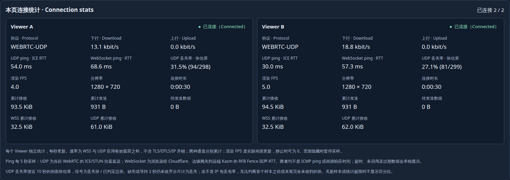

# US ARM64 native UAT

The third development fixture runs on native ARM64 with Alpine 3.24.3 and LXD.
It retains the current UDP, input, clipboard and diagnostics behavior using
architecture-specific artifacts. This continues Issue #36 / Draft PR #37;
it is not a formal release or physical keyboard acceptance.
The [dated results](results-udp-us-arm64-20261101.json) contain exact artifact
hashes, checks, unsuccessful attempts, cleanup and remaining scope.

## Artifacts and build checks

Core and edge source is `a7297f3fd5dd`; the component manifest is
`51905551ea09…`. Four Core binaries and two fixture helpers are static AArch64
ELF executables. Kasm remains a separately pinned native component with resolved
Alpine runtime libraries. No amd64 executables were installed on the target.

Runtime source and native patches match the preceding two-region candidate.
The server was compiled natively on ARM64; source/archive comparisons verified
its inputs before packaging with the updated provenance recipe. The browser
bundle differs only in esbuild's dependency-directory labels. Its bytes match
after normalizing that build path; the independent original hashes are retained.

All 55 applied component tests passed, including ASan/UBSan/leak checks using
Clang/compiler-rt. All Go packages passed on ARM64 with non-root test execution,
`xauth`, and the deployed `x11_static` build configuration. Test-only commit
`8eaeb8a03feb` supplies the existing systemctl stub to a persistence test that
otherwise depends on the host. That commit changes no production code, and
deployed artifacts remain pinned to `a7297f3fd5dd`. Full local `make check` and
both [build-tooling CI](https://github.com/woodegg/remotexapp/actions/runs/41261828976)
and [test-fixture CI](https://github.com/woodegg/remotexapp/actions/runs/41262672602)
passed. See the [Alpine procedure](ALPINE.md) for prerequisites.

## Deployment and live checks

The dedicated unprivileged container has one CPU and 1 GiB memory. Manager,
gateway, display server and applications run as UID 1000. OpenRC/runit owns
startup; the existing edge gateway serves pinned assets behind the existing
Cloudflare Access policy. Adding the protected hostname preserved all existing
tunnel ingress rules and other workload containers.

The owner enabled upstream UDP ingress. Both allocated public ports passed
round-trip tests through host proxy devices to container loopback. Host source
restrictions remain enabled and persistent. A namespace capture checked 400
UDP packets: all peers were loopback addresses. It also checked 21 HTTP requests
and three offers for stripped source headers and client candidates.

Three real Viewers on two displays passed actual paint checks. Both Viewers
sharing the managed desktop passed pointer movement, five mouse buttons,
double-click, dragging, wheel, focus, arrows and editing keys; Viewer A also
passed those checks over WSS. Chinese/Unicode composition with file readback,
both clipboard directions, explicit write consent, the 64 KiB boundary,
permission denial, four shortcut profiles and repeated outside/inside focus
cycles passed. These are CDP-driven input tests, not physical OS IME acceptance.

Missing, unknown, replayed and stale-generation WebSocket grants were rejected.
Revoking A left B connected; A reconnected with a new grant. Valid authenticated
STUN received a response, while missing/invalid integrity, unknown credentials
and retired Viewer credentials did not. An unrenewed Viewer expired after about
91 seconds. Exhausting the two UDP slots produced a WSS-only descriptor for the
additional disposable App, which was then stopped.

Manager restart preserved application processes and documents. Actual container
reboot recovered the managed runtime, advanced its generation and preserved
component pins and saved-document hashes. Three Viewers painted over UDP after
reboot with a changing-pixel workload. Initial checks on a static screen timed
out with ICE connected but no new UDP display data; adding ordinary updates
activated UDP without restarting the server or proxy.

## Diagnostics and limits

Both UDP ICE RTT and WebSocket Fence RTT were measured. A scoped receive-side
fault dropped 227 actual datagrams while both Viewers continued painting:

| Sample | Viewer A block loss | Viewer B block loss |
| --- | --- | --- |
| Before injection | 0% | 0% |
| During injection | 31.7% | 27.7% |
| After removal | 0% | 0% |

These are rolling display-block estimates, not IP packet-loss percentages or
regional performance benchmarks. Independent UDP preference, disconnect
clearing, fresh reconnect epochs, background Fence suspension, stale samples,
both UI surfaces and zero browser exceptions passed in the accepted run.

An additional setup attempt overlapped two browser tests: the expiry page took
foreground while other Viewers were connecting, and those connections timed
out. A subsequent positive control used stale credentials and was rejected.
Fresh serial setup and all authorization controls passed. Initial-connection
recovery after backgrounding remains unqualified; the failed attempt is retained.

Installed verification covered 21 Core files, 45 component files and 11 edge
files. Cleanup left one ready managed runtime, no failed runtimes and no test
Viewers. Owned fault rules, captures, animations, probe processes, temporary
test packages, browser tabs and copied-cookie profile were removed. The native
builder is stopped. Final runtime PSS was about 125 MiB with zero cgroup OOM
events; this single idle observation establishes no leak trend or capacity claim.

Physical UAT, other browser engines, a new ARM64 soak, the full earlier MTU/NAT/
proxy fault matrix, whole-host reboot, audio, file clipboard, embedding-host
integration and release qualification remain separate work.
