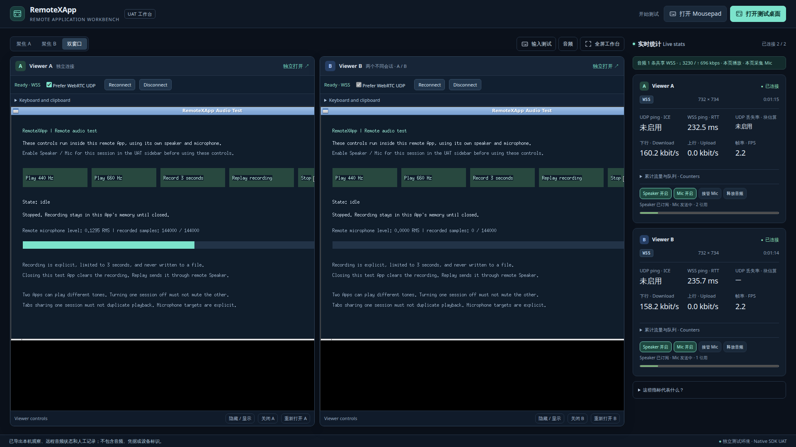

# Native audio candidate qualification

Candidate `792694956ce1c3fd21160797c6a65be0d09a0d4d` implements Core
`0.16.0-dev.4` / SDK `0.31.0-dev.4`. This record qualifies the opt-in D3 audio
implementation for one complete physical-device UAT. It does not accept a
release, a merged commit, production deployment or the downstream embedding host.
The [machine-readable record](qualification-7926949.json) binds the exact
static AMD64/ARM64 archives, installed page, harnesses and resource samples.
Private credentials, endpoints, runtime identifiers, recordings and deployment
logs are excluded.

## Evidence and boundaries

- Local real Pulse and Chrome tests exercise two domains, three tabs, actual
  waveform playback/readback, cross-profile conflict/takeover, shared ownership,
  permission denial/revocation, late consent, domain replacement, worker exit,
  last reference and final-App cleanup. The local fixture replaces only the
  Manager runtime resolver; it is not full App supervision evidence.
- Australia, China and US dedicated Alpine standalone UATs run the same source;
  US uses ARM64. Each runs real application launch, two served Viewers, 440/660 Hz
  output, selected/unselected 880 Hz microphone readback, three-second remote
  recording/replay, one capture for two targets and all-off cleanup.
- All three targets exercise normal stop of A while B continues actual mic
  readback, then vacancy shutdown after all Viewers close while audio interests
  remain. App/Pulse processes exit and private domain directories are removed.
- Australia additionally exercises three actual Viewers, playback-owner close,
  microphone-owner loss, private Pulse crash while B keeps its capture, active
  permission revocation, HTTP lease-network failure, silent Worker exit, SDK
  logout across tabs and Manager restart. The Manager adopts existing App and
  Pulse identities; Viewer reconnection remains an explicit existing action.
- The UAT page's separate browser fixture checks layout, local device controls,
  content-free export, unavailable states and audio bandwidth counter caching.
  Its simulated backend is not counted as remote playback evidence.

The source passes `make check`, `make test-race` and coverage gates. The source
vulnerability scan found no reachable vulnerabilities; no dependency changes
followed that scan. GitHub Verify also passes for the candidate. Chrome uses
synthetic devices with microphone DSP disabled only by test instrumentation;
the shipped SDK enables echo cancellation, noise suppression and gain control.

## Natural resource observation

The final run completed 61 samples over
1801.5 natural seconds with no forced GC. Every sample
had two actual App sessions with Viewer counts 2 + 1, three ready nonblank
canvases, one shared connection and one live capture. Known remote speaker and
microphone readback passed before and after the interval. Acceptance limits
were locked before live qualification; earlier runs do not contribute time.

| Observation | Result |
| --- | --- |
| Chrome process-tree PSS | 579.0–646.0 MiB |
| Manager PSS | 15.6–20.8 MiB |
| Final ten-minute PSS change: Chrome / Manager | +10.88 / -0.59 MiB; each ≤32 MiB |
| Largest surviving-process FD increase after five-minute warmup | 0; limit 8 |
| Attached DOM element change after warmup | 0; limit 100 |
| New microphone captures / browser exceptions during interval | 0 / 0 |
| Node observer RSS range | 72.1–82.1 MiB |
| Sampled playback amplitudes both above 0.05 | 59 / 61 samples; point observations, not continuous-quality proof |
| End cleanup | No PCM relays, no live capture tracks, shared WSS idle; tone producers reaped |

At about minute 15, Chrome PSS rose by roughly 36 MiB, mostly anonymous memory
in renderer processes, with little contemporaneous page JS heap growth and no
attached-DOM growth. It subsequently fluctuated. This observation is retained;
its allocation cause is not established, and the bounded final-window gate is
not a proof that the browser has no long-duration native-memory growth.

The JSON also includes anonymous PSS, RSS, page/Worker heap and backing storage,
raw CDP DOM counts, observer CPU/FDs, and worklet counters. Attached DOM is the
locked gate; raw CDP nodes include unreclaimed garbage. Resource samples include
instrumentation and do not estimate product-only browser cost.

During the interval, the coordinator's combined local discard counter increased
by 4896; playback worklet discards increased by
264 and microphone worklet discards by
0. Playback underrun blocks increased by
31438. These are bounded local scheduling/queue observations, not measured IP
packet loss or acoustic-quality acceptance. Physical UAT must assess audible
gaps and delay; the resource gate is not a claim of zero audio discontinuities.

Screenshot taken before the timed interval using synthetic audio. Focus A/B
provides the full App controls when a split Viewer is narrower than the App.

## Defects found and retained limitations

The verification found and repaired late microphone-ACK cleanup, silent worker
failure detection, Manager epoch fencing, final-App empty-connection cleanup,
per-speaker playback credit contention and a route recovery failure that could
reset another App's audio. The [P17 burst experiment](../performance/native-audio-burst/README.md)
records the bounded credit regression separately from WAN measurements. UAT
bandwidth no longer resets to zero on unchanged worklet counter updates, and a
successful B launch clears an earlier launch-error message.

Earlier resource attempts were stopped after defects were found and are not
passes; their minutes are not combined with the final candidate's natural
observation. An earlier China microphone check failed without a pre-stop
readback baseline; that exact transient was not attributed to a proven cause.
The final lifecycle checks require actual microphone readback before and after
stopping the other App on all three targets. A transient earlier App launch
failure is also not evidence of a diagnosed API timeout; the harness waits for
A's real Viewer readiness before launching B.

The audio path is PCM16/48 kHz over a separate WSS: stereo speaker payload is
1.536 Mbps per active App, and one mono microphone capture is 0.768 Mbps
upstream before protocol overhead. Bounded queues can discard delayed frames;
local queue/credit counters are not UDP/IP packet-loss statistics. This work
makes no new display UDP or acoustic-quality claim. The default display provider,
old runtime audio capability, original user App processes/generations and
existing document hashes were preserved. Superseded task listeners were stopped;
previous rollback artifacts and the pre-existing rollback service remain.

Each qualified UAT origin serves one Manager. Multiple Managers behind different
paths of one browser origin, cross-origin host bridging and the actual embedding host
adapter are not exercised by this record.

Full live Manager audio checks use the standalone/runit backend; this record
does not qualify a live systemd audio deployment.

This is one Linux Chrome version and a thirty-minute observation, not all
browser engines, physical operating-system/device combinations or an eight-hour
soak. Same-UID Pulse domains provide cooperative routing isolation; malicious
tenants require separate UIDs/containers. embedding host must adopt the independent audio
interest API, workspace references and login/logout hooks, then qualify its
own embedding behavior.

## One physical end-to-end UAT

Use a fresh browser tab after closing older UAT tabs so the SharedWorker and
SDK belong to this candidate. Headphones make playback/mic observations easier.

1. Open the audio panel, launch audio test A, then **B → new audio test**.
   Both apps start with audio off and no audio WSS.
2. Use **Focus A / Focus B** when a remote control does not fit the split view.
   Enable A Speaker and click **Play 440** in the remote App. Repeat with B and
   **Play 660**. Check independent switches, simultaneous playback, no duplicate
   sound and continuously visible connection/rate statistics.
3. Enable A Mic, grant browser permission, click remote **Record 3 sec**, speak,
   turn Mic off and click **Replay**. Repeat with B, then enable both mic targets
   to check one capture with explicitly selected destinations.
4. Open the same session in a new tab. Check shared switches, unique playback,
   owner-tab closure and no automatic microphone recapture. A second browser
   profile should show a writer conflict until explicit **Take over Mic**.
5. Hide/show the Viewer, deny/revoke microphone permission, then explicitly
   restore it. Finally turn all speakers/mics off and check the shared audio
   connection and browser capture indicator stop.
6. Record the checklist observations and export the content-free JSON. Report
   audible gaps, echo, device switching failures or excessive delay with the
   browser/OS and action sequence. The page never marks manual cases passed
   automatically.

Only that physical UAT remains for this standalone integration. Merge, formal
release and actual embedding host integration retain their own acceptance boundaries.
